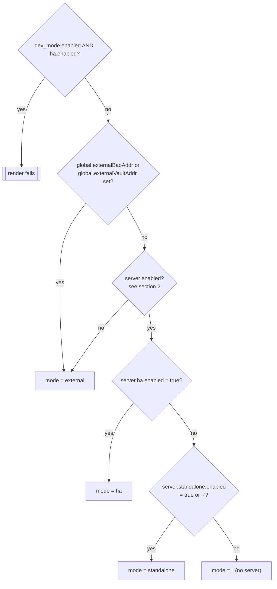
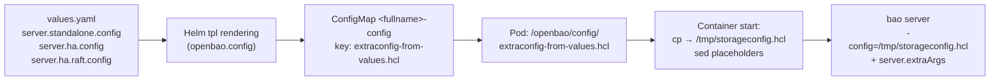
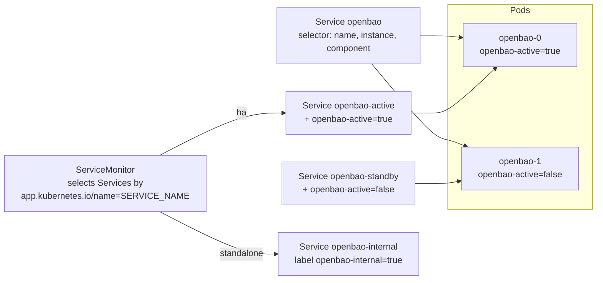
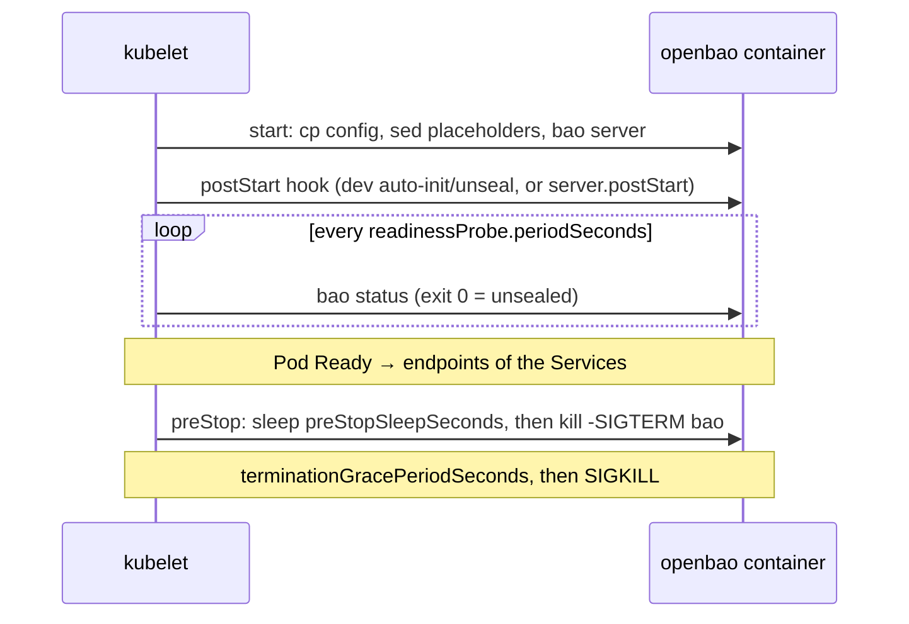
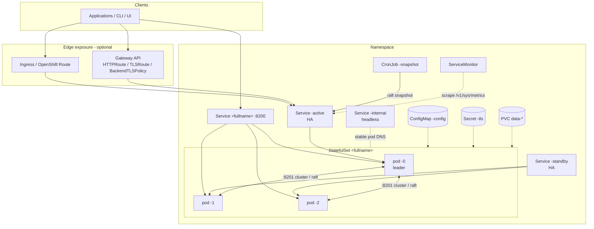

# Core Concepts

This document explains how the chart decides what to deploy and how the
OpenBao server configuration is built. The parameter reference and the mode
guides build on these concepts.

- [1. Deployment mode resolution](#1-deployment-mode-resolution)
- [2. Tri-state switches (`"-"`)](#2-tri-state-switches--)
- [3. What gets rendered in each mode](#3-what-gets-rendered-in-each-mode)
- [4. Server configuration pipeline](#4-server-configuration-pipeline)
- [5. Container environment](#5-container-environment)
- [6. Ports and the scheme](#6-ports-and-the-scheme)
- [7. Resource naming](#7-resource-naming)
- [8. Labels and selectors](#8-labels-and-selectors)
- [9. Values that accept templates](#9-values-that-accept-templates)
- [10. Pod lifecycle](#10-pod-lifecycle)
- [11. Architecture overview](#11-architecture-overview)

---

## 1. Deployment mode resolution

You do not set the topology with a single value. The `openbao.mode` helper
([`_helpers.tpl:180`](/charts/openbao/templates/_helpers.tpl)) derives it from
several switches and stores the result in `.mode`. Almost every template reads
`.mode`.

### Evaluation order



| Result | Trigger | Server workload |
|--------|---------|-----------------|
| *render error* | `server.dev_mode.enabled: true` **and** `server.ha.enabled: true` | Helm fails: `server.dev_mode.enabled and server.ha.enabled are mutually exclusive ...` |
| `external` | `global.externalBaoAddr` (or the deprecated `global.externalVaultAddr`) is non-empty, **or** the server is disabled | None |
| `ha` | `server.ha.enabled: true` | StatefulSet with `server.ha.replicas` pods (default `3`) |
| `standalone` | `server.standalone.enabled` is `true` or `"-"` (the default) | StatefulSet with 1 pod running a one-node integrated Raft cluster |
| `""` (empty) | `server.standalone.enabled: false` and HA is off | None. No StatefulSet, but the Services and an **empty** config ConfigMap are still rendered |

### How "dev mode" fits in

`server.dev_mode.enabled` is **not** a separate value of `.mode`. The helper
never sets `.mode` to `dev`. Dev mode is a modifier on top of the
**standalone** mode:

| Aspect | Effect of `server.dev_mode.enabled: true` |
|--------|-------------------------------------------|
| Resolved mode | Still `standalone` (when `standalone.enabled` is `"-"` or `true`) |
| HCL configuration | `server.standalone.config` is used. `server.dev_mode.config` is **not** rendered (see [14-known-issues.md](14-known-issues.md) #1) |
| `postStart` hook | Replaced with the built-in auto-init and auto-unseal script. Any custom `server.postStart` is ignored |
| HA | Not allowed. The render fails |

So the shipped default (`dev_mode.enabled: true`, `standalone.enabled: "-"`,
`ha.enabled: false`) is a standalone server with automatic bootstrap.

> **Pitfall.** With `dev_mode.enabled: true` and `standalone.enabled: false`
> the resolved mode is `""`, and the chart deploys **no server pods**. The
> Services, an empty ConfigMap, the ServiceAccount and the RBAC objects are
> still created.

### Examples

```yaml
# 1) Shipped default: standalone + auto-bootstrap
server:
  dev_mode: { enabled: true }
```

```yaml
# 2) Plain standalone: you initialize and unseal manually
server:
  dev_mode: { enabled: false }
  standalone: { enabled: true }
```

```yaml
# 3) HA with integrated Raft
server:
  dev_mode: { enabled: false }   # required: dev mode and HA are mutually exclusive
  ha:
    enabled: true
    raft: { enabled: true }
```

```yaml
# 4) External: no server, only auxiliary objects (for example the snapshot agent)
global:
  externalBaoAddr: https://openbao.example.com:8200
```

---

## 2. Tri-state switches (`"-"`)

Several `enabled` flags accept a third value, `"-"`, which means "follow
`global.enabled`".

| Value | Meaning |
|-------|---------|
| `true` | Enabled regardless of `global.enabled` |
| `false` | Disabled |
| `"-"` | Enabled only if `global.enabled` is `true` |

| Switch | Default | How it is evaluated |
|--------|---------|---------------------|
| `server.enabled` | `"-"` | `openbao.serverEnabled`: `true`, or `"-"` with `global.enabled: true` |
| `server.standalone.enabled` | `"-"` | `"-"` is treated the same as `true` in mode resolution |
| `ui.enabled` | `false` | `openbao.uiEnabled`: `true`, or `"-"` with `global.enabled: true` |

`global.enabled: false` therefore turns off the server unless
`server.enabled: true` is set explicitly:

```yaml
# Deploy only auxiliary objects (for example the snapshot agent) and no server
global:
  enabled: false
```

```yaml
# Disable everything by default, but keep the server
global:
  enabled: false
server:
  enabled: true
```

Always quote `"-"` in YAML. With `--set`, use `--set server.enabled=-`.

---

## 3. What gets rendered in each mode

The table shows which objects the chart creates with default values for each
resolved mode. "opt" means the object depends on an additional flag shown in
the last column.

| Resource | Name | standalone | ha | external | Extra condition |
|----------|------|:---:|:---:|:---:|-----------------|
| StatefulSet | `<fullname>` | ✔ | ✔ | - | |
| ConfigMap (server HCL) | `<fullname>-config` | ✔ | ✔ | - | Selected config is non-empty |
| PVC `data` | `data-<fullname>-N` | ✔ | opt | - | HA: only with `server.ha.raft.enabled: true` |
| PVC `audit` | `audit-<fullname>-N` | opt | opt | - | `server.auditStorage.enabled: true` |
| Service (client) | `<fullname>` | ✔ | ✔ | - | `server.service.enabled: true` |
| Service (headless) | `<fullname>-internal` | ✔ | ✔ | - | `server.service.enabled: true` |
| Service (active) | `<fullname>-active` | - | ✔ | - | `server.service.active.enabled: true` |
| Service (standby) | `<fullname>-standby` | - | ✔ | - | `server.service.standby.enabled: true` |
| Service (UI) | `<fullname>-ui` | opt | opt | - | `ui.enabled: true` |
| PodDisruptionBudget | `<fullname>` | - | ✔ | - | `server.ha.disruptionBudget.enabled: true` |
| Role + RoleBinding (discovery) | `<fullname>-discovery-role[binding]` | - | ✔ | - | `server.serviceAccount.serviceDiscovery.enabled: true` |
| ServiceAccount | `<fullname>` | ✔ | ✔ | ✔ | `server.serviceAccount.create: true` |
| ServiceAccount token Secret | `<fullname>-token` | opt | opt | opt | `server.serviceAccount.createSecret: true` |
| ClusterRoleBinding (`system:auth-delegator`) | `<fullname>-server-binding` | ✔ | ✔ | ✔ | `server.authDelegator.enabled: true` |
| cert-manager Certificate | `<fullname>-tls` | opt | opt | - | `global.tlsDisable: false` and `server.tls.source: certManager` |
| cert-manager Issuer (self-signed) | `<fullname>-issuer` | opt | opt | - | The above and `certManager.generateIssuer: true`, no `clusterIssuerName` |
| TLS Secret (inline PEM, Helm hook) | `<fullname>-tls` | opt | opt | - | `global.tlsDisable: false`, `source: rawCerts`, `crt` and `key` set |
| Ingress | `<fullname>` | opt | opt | - | `server.ingress.enabled: true` |
| OpenShift Route | `<fullname>` | opt | opt | - | `global.openshift: true` and `server.route.enabled: true` |
| HTTPRoute / TLSRoute | `<fullname>` | opt | opt | - | `server.gateway.httpRoute/tlsRoute.enabled: true` |
| BackendTLSPolicy | `<fullname>` | opt | opt | - | TLS on and `server.gateway.tlsPolicy.enabled: true` |
| NetworkPolicy | `<fullname>` | opt | opt | opt | `server.networkPolicy.enabled: true` |
| ServiceMonitor | `<fullname>` | opt | opt | opt | `serverTelemetry.serviceMonitor.enabled` or `global.serverTelemetry.prometheusOperator` |
| PrometheusRule | `<fullname>` | opt | opt | opt | The above **and** a non-empty `serverTelemetry.prometheusRules.rules` |
| Grafana dashboard ConfigMap | `<fullname>-dashboard` | opt | opt | opt | `serverTelemetry.grafanaDashboard.enabled: true` |
| Snapshot agent CronJob, ConfigMap, SA | `<fullname>-snapshot` | opt | opt | opt | `snapshotAgent.enabled: true` |

Points to note:

- **The data PVC is mandatory** whenever the backend keeps data on local disk
  (standalone and HA with Raft). `server.dataStorage` has no `enabled` switch.
- **HA without Raft** creates no data PVC. Data lives in the external
  backend. The default `server.ha.config` uses Consul, which OpenBao 2.x does
  not provide; use PostgreSQL instead (see
  [09-deployment-modes.md §5](09-deployment-modes.md#5-ha-with-external-storage)).
- The ServiceAccount and auth-delegator binding are created **even in external
  mode**, as long as `server.enabled: true` or `global.enabled: true`. An
  external OpenBao can then use this ServiceAccount's token (for example from
  `server.serviceAccount.createSecret: true`) as the `token_reviewer_jwt` for
  the Kubernetes auth method.

To see exactly what your values produce, render the chart locally:

```bash
helm template openbao ./charts/openbao -n openbao -f my-values.yaml \
  | grep -E '^(kind|  name):'
```

---

## 4. Server configuration pipeline

The OpenBao server reads one HCL file. The chart builds it in four stages:



### Stage 1: selecting the source value

| Resolved mode | `server.ha.raft.enabled` | Value used |
|---------------|--------------------------|------------|
| `standalone` | - | `server.standalone.config` |
| `ha` | `false` | `server.ha.config` (Consul storage by default; override it, see [09 §5](09-deployment-modes.md#5-ha-with-external-storage)) |
| `ha` | `true` | `server.ha.raft.config` (integrated Raft) |

### Stage 2: Helm templating

If the selected value is a **string**, the chart passes it through Helm's
`tpl`. The config can therefore contain template expressions, and the
defaults use them to follow TLS settings:

```hcl
listener "tcp" {
  address = "[::]:8200"
  cluster_address = "[::]:8201"
  {{- if .Values.global.tlsDisable }}
  tls_disable = 1
  {{- else }}
  tls_cert_file = "{{ .Values.server.tls.mountPath }}/{{ .Values.server.tls.certKey }}"
  tls_key_file  = "{{ .Values.server.tls.mountPath }}/{{ .Values.server.tls.keyKey }}"
  {{- end }}
}
```

If the value is a **map** (YAML object), the chart renders it with
`toPrettyJson`. The OpenBao config parser accepts JSON as well as HCL:

```yaml
server:
  standalone:
    config:
      ui: true
      listener:
        tcp:
          address: "[::]:8200"
          tls_disable: 1
      storage:
        raft:
          path: /openbao/data
```

> When you override a config string, you replace the **whole** default. Copy
> the default from `values.yaml` and edit it, so you keep the TLS conditionals
> and the `retry_join` blocks. Otherwise switching `global.tlsDisable` has no
> effect on the listener.

### Stage 3: ConfigMap and mount

The result is stored in ConfigMap `<fullname>-config` under the key
`extraconfig-from-values.hcl`. The ConfigMap is mounted at `/openbao/config`.

With `server.configAnnotation: true`, a SHA-256 checksum of the rendered
config is added as an annotation on the ConfigMap and on the pod template. A
config change then changes the pod template. With the default
`updateStrategyType: OnDelete` you still need to delete the pods, but
`kubectl get pods -o yaml` shows which pods run an old config.

### Stage 4: runtime placeholder substitution

The container command (`openbao.args`, [`_helpers.tpl:257`](/charts/openbao/templates/_helpers.tpl))
copies the file to `/tmp/storageconfig.hcl`. In standalone mode it then runs
the legacy `file`-data guard (`server.standalone.legacyFileDataCheck`, see
[05-storage.md](05-storage.md#legacy-file-data-on-the-volume)). It replaces these literal
placeholders with environment variable values, and only if the variable is
non-empty:

| Placeholder | Source variable | Set by the chart? | Typical use |
|-------------|-----------------|-------------------|-------------|
| `HOST_IP` | `status.hostIP` | Yes | Consul agent address: `address = "HOST_IP:8500"` |
| `POD_IP` | `status.podIP` | Yes | Listener or advertise addresses |
| `HOSTNAME` | Pod name | Yes | Per-pod values, for example `node_id = "HOSTNAME"` |
| `API_ADDR` | `API_ADDR` | **No**: provide it with `server.extraEnvironmentVars` | Custom `api_addr` |
| `TRANSIT_ADDR` | `TRANSIT_ADDR` | **No** | Transit auto-unseal: `address = "TRANSIT_ADDR"` |
| `RAFT_ADDR` | `RAFT_ADDR` | **No** | Custom Raft join addresses |

Example: Transit auto-unseal with the address supplied at runtime:

```yaml
server:
  extraEnvironmentVars:
    TRANSIT_ADDR: https://transit-openbao.example.com:8200
  extraSecretEnvironmentVars:
    - envName: BAO_TOKEN                 # read by the transit seal
      secretName: transit-unseal-token
      secretKey: token
  standalone:
    config: |
      ui = true
      listener "tcp" {
        address = "[::]:8200"
        tls_disable = 1
      }
      storage "raft" { path = "/openbao/data" }
      seal "transit" {
        address    = "TRANSIT_ADDR"
        key_name   = "autounseal"
        mount_path = "transit/"
      }
```

> `sed` replaces every occurrence of the placeholder text, including inside
> other words. For example, a path such as `/data/HOSTNAME_backup` would also
> change. Avoid these tokens in unrelated parts of your config.

Finally the server starts with:

```sh
/usr/local/bin/docker-entrypoint.sh bao server -config=/tmp/storageconfig.hcl <server.extraArgs>
```

```yaml
server:
  extraArgs: "-log-requests-level=info"   # appended verbatim
```

---

## 5. Container environment

The chart always sets these variables in the `openbao` container:

| Variable | Value | Purpose |
|----------|-------|---------|
| `HOST_IP`, `POD_IP` | Downward API | Placeholders, Consul address |
| `HOSTNAME` | Pod name | Placeholder, per-pod DNS |
| `BAO_K8S_POD_NAME`, `BAO_K8S_NAMESPACE` | Downward API | Used by `service_registration "kubernetes"` |
| `BAO_ADDR` | `<scheme>://127.0.0.1:8200` | Lets the in-pod CLI work without flags |
| `BAO_CACERT` | `<tls.mountPath>/<tls.caKey>` | Only when TLS is on. The CLI and probes verify the server certificate |
| `BAO_API_ADDR` | `server.ha.apiAddr`, or `<scheme>://$(POD_IP):8200` | Address advertised to clients and for request forwarding |
| `BAO_CLUSTER_ADDR` | `server.ha.clusterAddr`, or `https://$(HOSTNAME).<fullname>-internal:8201` | Cluster address. Always `https`: OpenBao cluster traffic uses its own TLS |
| `BAO_RAFT_NODE_ID` | Pod name | Only with `server.ha.raft.enabled` **and** `server.ha.raft.setNodeId` |
| `BAO_LOG_LEVEL` / `BAO_LOG_FORMAT` | `server.logLevel` / `server.logFormat` | Only when set |
| `HOME` | `/home/openbao` (`emptyDir`) | Location of the CLI token cache |
| `SKIP_CHOWN`, `SKIP_SETCAP` | `true` | Prevent the entrypoint from changing ownership or capabilities (non-root friendly) |

The chart then appends `server.extraSecretEnvironmentVars` and
`server.extraEnvironmentVars`. Keys of `extraEnvironmentVars` are
upper-cased, and `.` is replaced with `_`:

```yaml
server:
  extraEnvironmentVars:
    google.region: global      # becomes GOOGLE_REGION=global
```

---

## 6. Ports and the scheme

| Port | Container port name | On Services | Purpose |
|------|---------------------|-------------|---------|
| `8200` | `http` / `https` | client, headless, active, standby, UI | API and UI |
| `8201` | `https-internal` | client, headless, active, standby | Cluster traffic: request forwarding and Raft. Always TLS |
| `8202` | `http-rep` / `https-rep` | - (container only) | Replication |

The `openbao.scheme` helper returns `http` when `global.tlsDisable: true`
and `https` otherwise. The scheme is used in:

- port names (`http` or `https`) and `appProtocol` on Services;
- `BAO_ADDR` and the default `BAO_API_ADDR`;
- the probe scheme for `httpGet` probes;
- Raft `retry_join` addresses (`<scheme>://<fullname>-N.<fullname>-internal:8200`);
- the ServiceMonitor port and scheme defaults;
- the snapshot agent `BAO_ADDR`.

Because the port **name** changes with TLS, any external object that refers
to the port by name (for example a hand-written ServiceMonitor or
BackendTLSPolicy `sectionName`) must be updated when you toggle TLS.

`server.service.port` and `targetPort` change the Service port only. The
listener address `[::]:8200` is part of the HCL config, and the container
ports are fixed.

---

## 7. Resource naming

### `<fullname>`

`openbao.fullname` ([`_helpers.tpl:12`](/charts/openbao/templates/_helpers.tpl))
computes the prefix used by every object:

| Inputs | `<fullname>` |
|--------|--------------|
| `fullnameOverride: vault` | `vault` |
| Release `openbao` (contains the chart name) | `openbao` |
| Release `prod-openbao` | `prod-openbao` |
| Release `secrets` | `secrets-openbao` |
| Release `secrets`, `nameOverride: bao` | `secrets-bao` |

The result is truncated to 63 characters. `openbao.name` (the chart name, or
`nameOverride`) is used separately in pod selector labels.

### Derived names

| Object | Name |
|--------|------|
| Pods | `<fullname>-0`, `<fullname>-1`, ... |
| Pod DNS (stable) | `<fullname>-N.<fullname>-internal.<namespace>.svc` |
| Client / headless / active / standby / UI Services | `<fullname>`, `<fullname>-internal`, `<fullname>-active`, `<fullname>-standby`, `<fullname>-ui` |
| Config ConfigMap | `<fullname>-config` |
| Data / audit PVCs | `data-<fullname>-N`, `audit-<fullname>-N` |
| TLS Secret | `server.tls.secretName`, or `<fullname>-tls` |
| ServiceAccount | `server.serviceAccount.name`, or `<fullname>` (or `default` when `create: false` and no name) |
| Snapshot agent objects | `<fullname>-snapshot` |

> **Do not rename a running release.** Changing the release name,
> `nameOverride` or `fullnameOverride` changes the PVC names. The new pods
> get **empty** volumes, and the existing data stays in the old PVCs.
>
> The Raft `retry_join` blocks and the TLS certificate SANs are built from
> `<fullname>`. Both change automatically if the name changes, but existing
> Raft peers keep their old addresses.

### Namespace

All namespaced objects use `global.namespace` if it is set, otherwise the
Helm release namespace (`-n`).

---

## 8. Labels and selectors

The chart uses two label sets. Keep them apart when you write selectors.

### Identity labels (on object metadata)

These come from top-level values and are normally filled in by the Netcracker
deployer:

| Label | Value |
|-------|-------|
| `app.kubernetes.io/name` | `SERVICE_NAME` (default `openbao`) |
| `app.kubernetes.io/part-of` | `APPLICATION_NAME` (default `openbao`) |
| `app.kubernetes.io/managed-by` | `MANAGED_BY` (default `Helm`) |
| `deployment.netcracker.com/sessionId` | `DEPLOYMENT_SESSION_ID` (default empty) |
| `app.kubernetes.io/version` | `ARTIFACT_DESCRIPTOR_VERSION` (StatefulSet only; empty in standalone installs) |

### Pod selector labels (on pods, used by Services, PDB and StatefulSet)

| Label | Value |
|-------|-------|
| `app.kubernetes.io/name` | `openbao.name` (chart name or `nameOverride`) |
| `app.kubernetes.io/instance` | Release name |
| `component` | `server` (or `snapshot-agent` for the CronJob pods) |
| `openbao-active` | `"true"` or `"false"`. Set **at runtime** by OpenBao itself through `service_registration "kubernetes"` (HA configs only) |

`server.extraLabels` adds labels to the pods.
`server.service.instanceSelector.enabled: false` removes the `instance` label
from the client, active and standby Service selectors. Those Services then
also select OpenBao pods from other releases.

### How Services and the ServiceMonitor find pods



- The active and standby Services select on the runtime `openbao-active`
  label. In HA they stay empty until OpenBao is **unsealed** and registers
  itself. The default HA configs include `service_registration "kubernetes" {}`,
  and the chart grants the needed `pods` permissions through the discovery
  Role.
- The ServiceMonitor selects **Services** by
  `app.kubernetes.io/name: SERVICE_NAME`. If `SERVICE_NAME` is empty, no
  Service matches and metrics are never scraped.

---

## 9. Values that accept templates

Some values can be given either as YAML or as a **multi-line string**. Strings
are rendered with `tpl`, so they can reference `.Values`, `.Release` and the
chart helpers:

| Value | Type accepted |
|-------|---------------|
| `server.affinity` | string (tpl) or YAML |
| `server.topologySpreadConstraints` | string (tpl) or YAML |
| `server.tolerations` | string (tpl) or YAML |
| `server.nodeSelector` | string (tpl) or YAML |
| `server.annotations`, `server.statefulSet.annotations`, Service annotations, `ui.annotations`, Ingress, Route and Gateway annotations, ServiceAccount annotations | string (tpl) or YAML |
| `server.statefulSet.securityContext.pod` / `.container` | string (tpl) or YAML |
| `server.extraInitContainers`, `server.extraContainers` | YAML, rendered through `tpl` after `toYaml` |
| `server.image.tag` | string (tpl) |
| `server.standalone.config`, `server.ha.config`, `server.ha.raft.config` | string (tpl) or map (JSON) |

The default `server.affinity` is such a string:

```yaml
server:
  affinity: |
    podAntiAffinity:
      requiredDuringSchedulingIgnoredDuringExecution:
        - labelSelector:
            matchLabels:
              app.kubernetes.io/name: {{ template "openbao.name" . }}
              app.kubernetes.io/instance: "{{ .Release.Name }}"
              component: server
          topologyKey: kubernetes.io/hostname
```

This **required** anti-affinity places each replica on a different node. A
3-replica HA cluster therefore needs at least 3 schedulable nodes. On a
single-node cluster (minikube, kind), switch to the preferred form or clear
the value:

```yaml
server:
  affinity: ""     # no anti-affinity
```

---

## 10. Pod lifecycle



| Phase | Controlled by | Default |
|-------|---------------|---------|
| Start | `openbao.args` | Copy config, substitute placeholders, run `bao server` |
| `postStart` | `server.dev_mode.enabled` (built-in script) or `server.postStart` | Dev auto-bootstrap |
| Readiness | `server.readinessProbe.*` | Exec `bao status`. With `path` set, an `httpGet` probe is used instead |
| Liveness | `server.livenessProbe.*` | Disabled. With `execCommand` set, an exec probe is used instead of `httpGet` on `path` |
| `preStop` | `server.preStopSleepSeconds` | `sleep 5`, then `SIGTERM` to `bao`, so endpoints are removed before shutdown |
| Termination | `server.terminationGracePeriodSeconds` | `10` seconds |
| Updates | `server.updateStrategyType` | `OnDelete`: pods are replaced only when you delete them |
| Pod order | `server.podManagementPolicy` | `OrderedReady` |

Two consequences for operations:

- A **sealed** pod is never Ready with the default exec probe. Its pod IP
  still appears behind the client Service, because
  `server.service.publishNotReadyAddresses: true` keeps not-ready pods in the
  endpoints so Raft can join through Service DNS. Clients may therefore reach
  a sealed node and get `503`.
- With `OrderedReady`, pod `-1` is created only after `-0` is Ready. In HA
  without auto-unseal, unseal `-0` first. To start all pods at once, set
  `server.podManagementPolicy: Parallel`.

---

## 11. Architecture overview



In standalone mode there is a single pod (a one-node Raft cluster, always
the leader once unsealed), no active or standby Services, and
Ingress, Gateway and the snapshot agent target the client Service instead of
`-active`.

## Next steps

- Parameter reference, starting with [03-global-and-identity.md](03-global-and-identity.md).
- Mode-specific guides with complete values files in [09-deployment-modes.md](09-deployment-modes.md).
