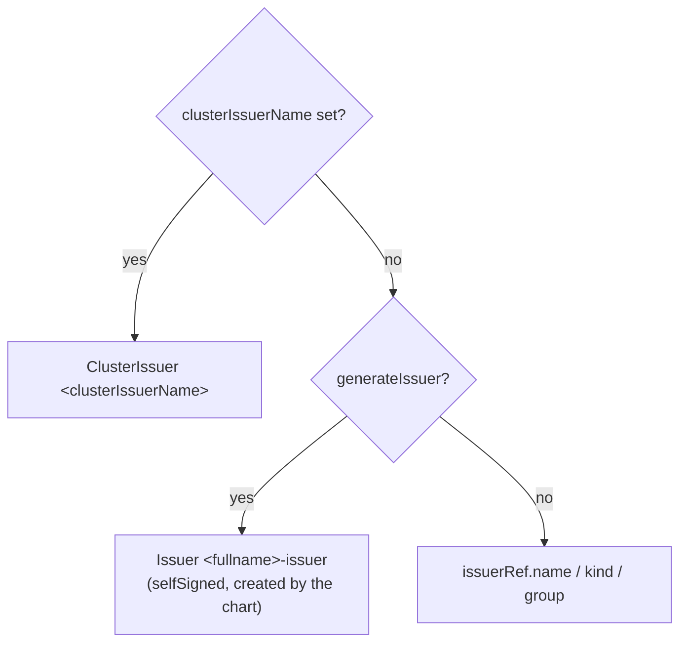

# End-to-End TLS

This document describes how to serve the OpenBao API over HTTPS, how the
certificate is provisioned, and what else changes when TLS is on.

- [1. The two switches](#1-the-two-switches)
- [2. Render-time validation](#2-render-time-validation)
- [3. Certificate sources](#3-certificate-sources)
- [4. Source `certManager`](#4-source-certmanager)
- [5. Source `rawCerts`](#5-source-rawcerts)
- [6. Source `existingSecret`](#6-source-existingsecret)
- [7. Listener settings](#7-listener-settings)
- [8. Enabling TLS on a running release](#8-enabling-tls-on-a-running-release)
- [9. Certificate rotation](#9-certificate-rotation)
- [10. Pitfalls](#10-pitfalls)

> Examples in this document have not yet been checked with `helm template`.

---

## 1. The two switches

| Switch | Role |
|--------|------|
| `global.tlsDisable` | **On/off.** `true` (default) serves plain HTTP. `false` turns TLS on |
| `server.tls.*` | **How.** Where the certificate comes from and how the listener uses it. Has no effect while `global.tlsDisable: true` |

With `global.tlsDisable: false` the chart:

1. provisions or references a `kubernetes.io/tls` Secret named
   `server.tls.secretName` (default `<fullname>-tls`);
2. mounts it read-only at `server.tls.mountPath` (default `/openbao/tls`);
3. renders the listener in the default HCL with `tls_cert_file`,
   `tls_key_file`, `tls_min_version` and optionally `tls_cipher_suites`;
4. switches the scheme to `https` everywhere (see
   [03-global-and-identity.md §5](03-global-and-identity.md#5-globaltlsdisable));
5. sets `BAO_CACERT=<mountPath>/<caKey>` in the server container, so the
   in-pod CLI and the exec readiness probe verify the certificate;
6. configures the ServiceMonitor and the snapshot agent to trust the same CA.

Cluster traffic on port `8201` uses TLS in every mode. OpenBao generates its
own certificates for it, independent of `server.tls`.

If you write your own HCL config, you must handle TLS in the listener block
yourself. Keep the template conditionals from the default config. See
[02-concepts.md §4](02-concepts.md#4-server-configuration-pipeline).

---

## 2. Render-time validation

The `openbao.tls.validate` helper
([`_helpers.tpl:1198`](/charts/openbao/templates/_helpers.tpl)) stops the
render when the two switches disagree. It runs for server modes only.

| # | Condition | Error message (shortened) | Fix |
|---|-----------|---------------------------|-----|
| 1 | `global.tlsDisable: true` and any of `server.tls.certs.crt`, `certs.key`, `certs.ca` or `server.tls.secretName` is set | `server.tls material is set ... but global.tlsDisable is true` | Set `global.tlsDisable: false`, or remove the TLS material |
| 2 | TLS on, `source: rawCerts`, `crt` or `key` empty | `server.tls.source=rawCerts with global.tlsDisable=false requires both server.tls.certs.crt and server.tls.certs.key` | Provide both PEM blocks |
| 3 | TLS on, `source: existingSecret`, `secretName` empty | `server.tls.source=existingSecret ... requires server.tls.secretName` | Set the Secret name |

In addition, `values.schema.json` checks the same requirements for
`rawCerts` and `existingSecret` **regardless of `global.tlsDisable`**, and
restricts `source` to `certManager`, `rawCerts` or `existingSecret`. Setting
`source: rawCerts` without certificates fails schema validation even when
TLS is off.

Rule 1 means `server.tls.secretName` cannot be preset while TLS is off. Set
it in the same change that sets `global.tlsDisable: false`.

---

## 3. Certificate sources

| `server.tls.source` | Who creates the Secret | Objects rendered by the chart | Needs |
|---------------------|------------------------|-------------------------------|-------|
| `certManager` (default) | cert-manager | `Certificate` `<fullname>-tls`, optionally `Issuer` `<fullname>-issuer` | cert-manager |
| `rawCerts` | the chart, from inline PEM | `Secret` `<secretName>` (Helm pre-install and pre-upgrade hook) | Certificate and key at hand |
| `existingSecret` | you | none | A `kubernetes.io/tls` Secret in the namespace |

### Common keys

| Key | Type | Default | Meaning |
|-----|------|---------|---------|
| `server.tls.secretName` | string | `""` (→ `<fullname>-tls`) | Secret name for all sources |
| `server.tls.certKey` | string | `tls.crt` | Key of the certificate in the Secret |
| `server.tls.keyKey` | string | `tls.key` | Key of the private key |
| `server.tls.caKey` | string | `ca.crt` | Key of the CA certificate. Used for `BAO_CACERT`, the ServiceMonitor and the BackendTLSPolicy |
| `server.tls.mountPath` | string | `/openbao/tls` | Mount directory in the server and snapshot agent containers |

---

## 4. Source `certManager`

| Key | Type | Default | Meaning |
|-----|------|---------|---------|
| `server.tls.certManager.generateIssuer` | bool | `false` | Create a self-signed `Issuer` `<fullname>-issuer` |
| `server.tls.certManager.clusterIssuerName` | string | `""` | Use this `ClusterIssuer` |
| `server.tls.certManager.issuerRef.name` | string | `openbao-ca-issuer` | Issuer to use when the two keys above are not set |
| `server.tls.certManager.issuerRef.kind` | string | `Issuer` | `Issuer` or `ClusterIssuer` |
| `server.tls.certManager.issuerRef.group` | string | `cert-manager.io` | Issuer API group |
| `server.tls.certManager.duration` | string | `8760h` | Certificate lifetime. Takes precedence over `durationDays` |
| `server.tls.certManager.durationDays` | int | `365` | Used only when `duration` is empty (`durationDays * 24h`) |
| `server.tls.certManager.renewBefore` | string | `720h` | Renew this long before expiry |
| `server.tls.certManager.privateKey` | map | `{algorithm: ECDSA, size: 256, rotationPolicy: Always}` | `spec.privateKey`, passed through |
| `server.tls.certManager.extraSans` | list | `[]` | Extra DNS names |
| `server.tls.certManager.extraIpSans` | list | `[]` | Extra IP addresses |
| `server.tls.certManager.subjectAlternativeName.additionalDnsNames` | list (or map) | `{}` | More DNS names (seaweedfs-compatible) |
| `server.tls.certManager.subjectAlternativeName.additionalIpAddresses` | list (or map) | `{}` | More IP addresses |

### Issuer selection



| Option | Trust | Good for |
|--------|-------|----------|
| `generateIssuer: true` | Self-signed. Each certificate is its own CA, so `ca.crt` is the certificate itself | Dev, test, internal traffic that trusts only `ca.crt` from the Secret |
| `clusterIssuerName` | Your corporate or cluster CA | Production. Clients already trust the CA |
| `issuerRef` | A namespaced CA `Issuer` you manage | Per-namespace CAs |

With `generateIssuer: true`, `rotationPolicy: Always` gives a new key and a
new self-signed "CA" on every renewal. Clients that pinned the old `ca.crt`
must reload it. Use a real CA in production.

The default `issuerRef.name: openbao-ca-issuer` does not exist unless you
create it. If you set none of the three options, the `Certificate` stays
`Ready=False` and the pod cannot mount the Secret. A minimal CA chain for
`issuerRef` is in [`docs/configuration.md`](/docs/configuration.md#option-a-cert-manager-recommended).

### Subject alternative names

`commonName` is `<fullname>`. The chart always adds these DNS names (shown
for `<fullname>=openbao`, namespace `openbao`):

| Group | Names |
|-------|-------|
| Client Service | `openbao`, `openbao.openbao`, `openbao.openbao.svc`, `openbao.openbao.svc.cluster.local` |
| Headless Service | `openbao-internal`, `.openbao`, `.openbao.svc`, `.openbao.svc.cluster.local` |
| Per-pod wildcards | `*.openbao-internal`, `*.openbao-internal.openbao.svc.cluster.local` |
| HA only | the same four forms for `openbao-active` and `openbao-standby` |
| Local | `localhost`, IP `127.0.0.1` |

These cover `BAO_ADDR` (`127.0.0.1`), `BAO_CLUSTER_ADDR` and Raft
`retry_join` (`<pod>.openbao-internal`), the ServiceMonitor (`serverName:
openbao`), the snapshot agent (`openbao-active.openbao.svc` or
`openbao.openbao.svc`) and the BackendTLSPolicy (`hostname: openbao`).

Not covered:

- `*.openbao-internal.openbao` and `*.openbao-internal.openbao.svc`. Use the
  short or the fully qualified pod name.
- A custom `cluster.local` domain. Add the names with `extraSans`.
- Public host names for Ingress passthrough, Route passthrough or TLSRoute.
  Add them with `extraSans`.

### Examples

Self-signed for development:

```yaml
global:
  tlsDisable: false
server:
  tls:
    source: certManager
    certManager:
      generateIssuer: true
```

Corporate ClusterIssuer with a public name and an RSA key:

```yaml
global:
  tlsDisable: false
server:
  tls:
    source: certManager
    tlsMinVersion: tls12
    certManager:
      clusterIssuerName: corp-ca
      duration: 2160h       # 90 days
      renewBefore: 360h     # 15 days
      privateKey:
        algorithm: RSA
        encoding: PKCS1
        size: 2048
        rotationPolicy: Always
      extraSans:
        - openbao.example.com
      extraIpSans:
        - 10.20.30.40
```

Check the result:

```bash
kubectl -n openbao get certificate openbao-tls
kubectl -n openbao describe certificate openbao-tls
kubectl -n openbao get secret openbao-tls -o jsonpath='{.data.tls\.crt}' \
  | base64 -d | openssl x509 -noout -text | grep -A1 "Subject Alternative Name"
```

---

## 5. Source `rawCerts`

| Key | Type | Default | Meaning |
|-----|------|---------|---------|
| `server.tls.certs.crt` | string (PEM) | `""` | Server certificate. Append intermediates after the leaf |
| `server.tls.certs.key` | string (PEM) | `""` | Private key |
| `server.tls.certs.ca` | string (PEM) | `""` | Optional CA certificate, stored under `caKey` |

The chart creates a `kubernetes.io/tls` Secret with the Helm annotations
`pre-install,pre-upgrade`, weight `-5` and delete policy
`before-hook-creation`. The Secret exists before the pod starts, and it is
recreated on each upgrade.

Pass the material from files, not inline in a committed values file:

```bash
helm upgrade --install openbao ./charts/openbao -n openbao \
  --set global.tlsDisable=false \
  --set server.tls.source=rawCerts \
  --set-file server.tls.certs.crt=./tls/openbao.crt \
  --set-file server.tls.certs.key=./tls/openbao.key \
  --set-file server.tls.certs.ca=./tls/ca.crt
```

The certificate must include the names listed in
[§4 Subject alternative names](#subject-alternative-names), at least
`127.0.0.1`, `<fullname>` and `*.<fullname>-internal`. A quick self-signed
certificate for testing:

```bash
FN=openbao NS=openbao
openssl req -x509 -newkey ec -pkeyopt ec_paramgen_curve:P-256 -nodes -days 365 \
  -keyout tls.key -out tls.crt -subj "/CN=$FN" \
  -addext "subjectAltName=DNS:$FN,DNS:$FN.$NS.svc,DNS:$FN-internal,DNS:*.$FN-internal,DNS:$FN-active,DNS:$FN-active.$NS.svc,DNS:localhost,IP:127.0.0.1"
cp tls.crt ca.crt     # a self-signed certificate is its own CA
```

### Pitfalls

- **Missing `ca`.** `BAO_CACERT` still points to `/openbao/tls/ca.crt`, but
  the file does not exist. The exec readiness probe (`bao status`) then
  fails and the pod never becomes Ready. Provide `ca`, or switch the probe to
  `httpGet`, which does not verify the certificate:

  ```yaml
  server:
    readinessProbe:
      path: /v1/sys/health?standbyok=true
  serverTelemetry:
    serviceMonitor:
      insecureSkipVerify: true
  ```

- **Hook ownership.** Hook resources are not part of the release.
  `helm uninstall` does not delete the Secret. Remove it by hand.
- **Secrets in values.** Helm stores the values, including the private key,
  in the release Secret. Anyone who can read Helm release Secrets in the
  namespace can read the key. Prefer `existingSecret` or `certManager` in
  production.

---

## 6. Source `existingSecret`

The chart only references the Secret. It must exist before the pod starts:

```bash
kubectl -n openbao create secret generic my-openbao-tls \
  --type=kubernetes.io/tls \
  --from-file=tls.crt=./openbao.crt \
  --from-file=tls.key=./openbao.key \
  --from-file=ca.crt=./ca.crt
```

`kubectl create secret tls` does not accept a CA file. Use `generic` with
`--type`, as above, to include `ca.crt`.

```yaml
global:
  tlsDisable: false
server:
  tls:
    source: existingSecret
    secretName: my-openbao-tls
```

Secrets with other key names, for example from an external secrets operator:

```yaml
server:
  tls:
    source: existingSecret
    secretName: openbao-cert-from-vault
    certKey: certificate.pem
    keyKey: private_key.pem
    caKey: issuing_ca.pem
```

The same `ca.crt` pitfall applies as for `rawCerts`.

---

## 7. Listener settings

| Key | Type | Default | Rendered into the default HCL |
|-----|------|---------|-------------------------------|
| `server.tls.tlsMinVersion` | string | `tls12` | `tls_min_version`. One of `tls10`, `tls11`, `tls12`, `tls13` |
| `server.tls.tlsCipherSuites` | string | `""` | `tls_cipher_suites`, only when set. Affects TLS 1.2 only |

Rendered listener (standalone, TLS on):

```hcl
listener "tcp" {
  address = "[::]:8200"
  cluster_address = "[::]:8201"
  tls_disable = 0
  tls_cert_file = "/openbao/tls/tls.crt"
  tls_key_file  = "/openbao/tls/tls.key"
  tls_min_version = "tls12"
}
```

Restricting TLS 1.2 to modern AEAD suites:

```yaml
server:
  tls:
    tlsMinVersion: tls12
    tlsCipherSuites: "TLS_ECDHE_ECDSA_WITH_AES_128_GCM_SHA256,TLS_ECDHE_ECDSA_WITH_AES_256_GCM_SHA384,TLS_ECDHE_ECDSA_WITH_CHACHA20_POLY1305"
```

Use `ECDHE_ECDSA` suites with the default ECDSA key and `ECDHE_RSA` suites
with an RSA key. A mismatch leaves no usable cipher, and TLS 1.2 handshakes
fail.

`tls13` only is the strictest choice. Older clients and some load balancer
health checks then cannot connect.

---

## 8. Enabling TLS on a running release

Changing `global.tlsDisable` from `true` to `false` updates both the config
ConfigMap and the pod template. Because of the defaults
(`updateStrategyType: OnDelete`, `configAnnotation: false`), running pods
keep serving HTTP while clients, probes and metrics already expect HTTPS.

Procedure:

1. For `existingSecret`, create the Secret first. For `certManager`, make sure
   the issuer exists.
2. Upgrade:

   ```bash
   helm upgrade openbao ./charts/openbao -n openbao -f values.yaml \
     --set global.tlsDisable=false
   ```

3. Wait for the certificate (`certManager` only):

   ```bash
   kubectl -n openbao wait --for=condition=Ready certificate/openbao-tls --timeout=120s
   ```

4. Restart the pods. In HA, restart standbys first, then step down and
   restart the leader:

   ```bash
   kubectl -n openbao delete pod openbao-2   # unseal, wait for Ready
   kubectl -n openbao delete pod openbao-1   # unseal, wait for Ready
   kubectl -n openbao exec openbao-0 -- bao operator step-down
   kubectl -n openbao delete pod openbao-0
   ```

5. Update external clients to `https://` and give them the CA.

During the change, Raft peers that have restarted join the leader at
`https://...:8200` (`retry_join`). A leader that still serves HTTP rejects
these joins until it restarts too. Existing members stay in the cluster,
because their cluster traffic on `8201` already uses TLS.

To roll out automatically on later config changes, set
`server.configAnnotation: true` and `server.updateStrategyType: RollingUpdate`
(only with auto-unseal).

---

## 9. Certificate rotation

| Source | Who renews the Secret |
|--------|-----------------------|
| `certManager` | cert-manager, `renewBefore` before expiry |
| `rawCerts` | you: `helm upgrade` with the new files (the hook recreates the Secret) |
| `existingSecret` | you, or your secrets operator |

The kubelet refreshes Secret volumes in the pod after about a minute (the
chart mounts the whole Secret, not `subPath`). OpenBao loads the listener
certificate at startup and reloads it on `SIGHUP` (verify for your OpenBao
version). After a renewal, reload each pod:

```bash
for p in openbao-0 openbao-1 openbao-2; do
  kubectl -n openbao exec "$p" -- sh -c 'kill -HUP $(pidof bao)'
done
```

Or restart the pods as in [§8](#8-enabling-tls-on-a-running-release). A
sidecar with `server.shareProcessNamespace: true` can automate the `SIGHUP`.

Check what the server presents:

```bash
kubectl -n openbao exec openbao-0 -- sh -c \
  'echo | openssl s_client -connect 127.0.0.1:8200 2>/dev/null | openssl x509 -noout -dates'
```

The OpenBao image may not include `openssl`. Run the same command from a
debug pod or through `kubectl port-forward` if it does not.

---

## 10. Pitfalls

| Symptom | Cause | Fix |
|---------|-------|-----|
| Pod stuck in `ContainerCreating`, event `secret "openbao-tls" not found` | The certificate is not issued yet, the issuer does not exist, or the existing Secret is missing | `kubectl describe certificate openbao-tls`. Create the issuer or the Secret |
| Pod `Running` but never Ready; `bao status` fails with `x509` | `ca.crt` is missing or does not sign the server certificate, or `127.0.0.1` is not a SAN | Provide the right CA, add the SAN, or use an `httpGet` readiness probe |
| Raft followers cannot join: `x509: certificate is valid for ..., not openbao-0.openbao-internal` | Custom certificate without `*.<fullname>-internal` | Add the wildcard SAN |
| ServiceMonitor target down with `x509` | `serverName` (`<fullname>`) not in the certificate, or no `ca.crt` | Add `<fullname>` as a SAN, or set `insecureSkipVerify: true` |
| Render fails with "TLS material is set but global.tlsDisable is true" | `server.tls.secretName` or `certs.*` set while TLS is off | See [§2](#2-render-time-validation) |
| Clients get `Client sent an HTTP request to an HTTPS server` | Clients still use `http://` | Update `BAO_ADDR` and client URLs |
| A values file enables TLS with empty placeholder PEM blocks (the old `examples/dev.yaml` did) | The chart renders, but the server cannot load the certificate | Supply real certificates, use cert-manager, or set `global.tlsDisable: true` |
