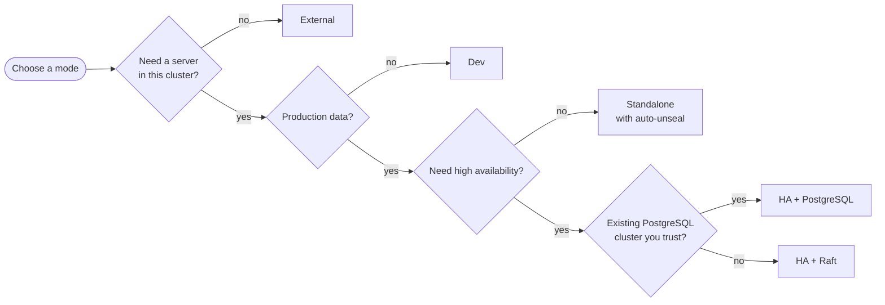
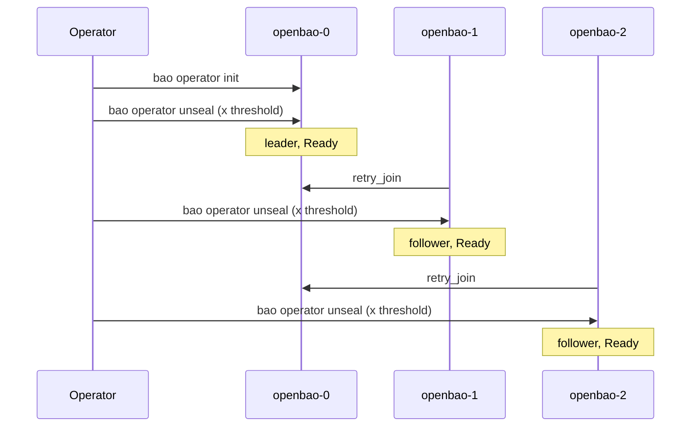

# Deployment Modes

This document is the practical guide to every topology the chart supports.
For each mode it gives a complete values file, the objects that are created,
the rendered server configuration, the first-start procedure, day-2
operations and the limitations. The last sections compare the modes and
describe how to move from one to another.

- [1. Overview](#1-overview)
- [2. Dev mode](#2-dev-mode)
- [3. Standalone mode](#3-standalone-mode)
- [4. HA with integrated Raft](#4-ha-with-integrated-raft)
- [5. HA with external storage](#5-ha-with-external-storage)
- [6. External mode](#6-external-mode)
- [7. Mode comparison](#7-mode-comparison)
- [8. Migrating between modes](#8-migrating-between-modes)

> Examples in this document have not yet been checked with `helm template`
> or on a live cluster. Statements marked "(verify)" depend on OpenBao
> runtime behavior that should be confirmed for your version.

Every mode section uses the same structure:

1. **Purpose**: what the mode is for and when to choose it.
2. **Values**: a minimal and a production-oriented values file.
3. **Rendered objects**: what the chart creates.
4. **Server configuration**: the HCL the server receives.
5. **First start**: initialization and unseal.
6. **Operations**: upgrades, scaling, backups.
7. **Limitations**.

The mode is derived from several switches. If you have not read it yet, see
[02-concepts.md §1](02-concepts.md#1-deployment-mode-resolution).

---

## 1. Overview

| Mode | Switches | Replicas | Storage | Unseal | Production |
|------|----------|----------|---------|--------|------------|
| [Dev](#2-dev-mode) | `dev_mode.enabled: true` (**default**) | 1 | `file` on a PVC | Automatic (key on the PVC) | No |
| [Standalone](#3-standalone-mode) | `dev_mode.enabled: false`, `standalone.enabled: true` or `"-"` | 1 | `file` on a PVC | Manual or auto-unseal | Limited |
| [HA + Raft](#4-ha-with-integrated-raft) | `dev_mode.enabled: false`, `ha.enabled: true`, `ha.raft.enabled: true` | 3 (or 5) | Integrated Raft, one PVC per pod | Manual or auto-unseal | **Yes** (recommended) |
| [HA + external storage](#5-ha-with-external-storage) | `dev_mode.enabled: false`, `ha.enabled: true`, `ha.raft.enabled: false` | 2 or more | External database (PostgreSQL) | Manual or auto-unseal | Yes |
| [External](#6-external-mode) | `global.externalBaoAddr` set | 0 | Outside the cluster | n/a | n/a |



---

## 2. Dev mode

### 2.1 Purpose

A single, self-bootstrapping OpenBao for development, demos and CI. It needs
no manual steps: the server initializes itself on first start and unseals
itself on every restart. Data is stored on a PVC, so it survives restarts.

Choose it when the data has no value and convenience matters more than
security.

### 2.2 Values

The chart defaults already give dev mode. The shipped example
[`examples/dev.yaml`](../../examples/dev.yaml) adds small resources, a 1Gi
PVC that is deleted with the StatefulSet, and no anti-affinity:

```bash
helm upgrade --install openbao ./charts/openbao -n openbao --create-namespace \
  -f examples/dev.yaml
```

Or with the shipped profile:

```bash
helm upgrade --install openbao ./charts/openbao -n openbao --create-namespace \
  -f charts/openbao/resource-profiles/dev.yaml
```

Dev mode with TLS, for testing TLS clients. Because the resolved mode is
`standalone`, the TLS Secret is mounted and the listener uses it (see
[§2.4](#24-server-configuration)):

```yaml
global:
  tlsDisable: false
server:
  dev_mode:
    enabled: true
  tls:
    source: certManager
    certManager:
      generateIssuer: true
```

Dev mode with TLS needs a CA that the in-pod CLI trusts: the bootstrap
script and the readiness probe run `bao status` with `BAO_CACERT` (see
[14-known-issues.md](14-known-issues.md) #4). The cert-manager source
provides `ca.crt`.

### 2.3 Rendered objects

Dev mode resolves to the `standalone` mode internally. It renders the same
objects as [standalone](#33-rendered-objects), and in addition replaces the
`postStart` hook with the bootstrap script.

### 2.4 Server configuration

The `server.dev_mode.config` value is **not used**. The `openbao.mode` helper
never returns `dev`, so the config ConfigMap is built from
`server.standalone.config`. The rendered HCL with TLS off:

```hcl
ui = true

listener "tcp" {
  address = "[::]:8200"
  cluster_address = "[::]:8201"
  tls_disable = 1
}
storage "file" {
  path = "/openbao/data"
}
```

To customize the dev server, edit `server.standalone.config`, not
`server.dev_mode.config`.

### 2.5 First start

No action is needed. The bootstrap script in the `postStart` hook:

1. waits up to 60 seconds for the API;
2. on the first start, runs `bao operator init -key-shares=1 -key-threshold=1`
   and stores the output in `<dataStorage.mountPath>/bootstrap-keys.json`;
3. on every start, unseals the server with the key from that file.

Read the root token:

```bash
kubectl -n openbao exec openbao-0 -- cat /openbao/data/bootstrap-keys.json
```

Bootstrap log:

```bash
kubectl -n openbao exec openbao-0 -- cat /tmp/openbao.log
```

The script uses `set -e`. If initialization fails (for example, the API does
not come up within 60 seconds), the hook fails, and the kubelet kills and
restarts the container.

### 2.6 Operations

| Task | How |
|------|-----|
| Restart | `kubectl -n openbao delete pod openbao-0`. The pod comes back unsealed |
| Upgrade the chart or OpenBao | `helm upgrade ...`, then delete the pod (`OnDelete` strategy) |
| Reset all data | `helm uninstall`, `kubectl delete pvc data-openbao-0`, install again |
| Move to standalone and keep the data | [§8.1](#81-dev-to-standalone) |

### 2.7 Limitations

- **Insecure by design.** The only unseal key and the root token are stored
  in plain text on the data volume. Anyone with `pods/exec` or access to the
  volume or its backups has full access.
- Single replica only. `dev_mode.enabled: true` together with
  `ha.enabled: true` fails the render.
- `server.postStart` is ignored.
- Uses the `file` storage backend. OpenBao documents it as not recommended
  for production, because it is not transactional and has no file locking.
- With `dev_mode.enabled: true` and `standalone.enabled: false`, no server
  pod is deployed at all.

---

## 3. Standalone mode

### 3.1 Purpose

A single OpenBao server that **you** initialize and unseal, or that unseals
itself through an external key management service. It is the simplest
non-dev topology.

Choose it for small internal installations where an outage during a pod
restart or node failure is acceptable, ideally with auto-unseal.

### 3.2 Values

Minimal:

```yaml
# Minimal standalone values (TLS off). The shipped examples/standalone.yaml
# adds TLS, an audit volume and hardening.
server:
  dev_mode:
    enabled: false
  standalone:
    enabled: true
  dataStorage:
    size: 10Gi
```

Production-oriented, with TLS, an audit volume and Transit auto-unseal:

```yaml
global:
  tlsDisable: false

server:
  dev_mode:
    enabled: false
  standalone:
    enabled: true
    config: |
      ui = true

      listener "tcp" {
        address = "[::]:8200"
        cluster_address = "[::]:8201"
        {{- if .Values.global.tlsDisable }}
        tls_disable = 1
        {{- else }}
        tls_cert_file = "{{ .Values.server.tls.mountPath }}/{{ .Values.server.tls.certKey }}"
        tls_key_file  = "{{ .Values.server.tls.mountPath }}/{{ .Values.server.tls.keyKey }}"
        tls_min_version = "{{ .Values.server.tls.tlsMinVersion }}"
        {{- end }}
      }

      storage "file" {
        path = "{{ .Values.server.dataStorage.mountPath }}"
      }

      seal "transit" {
        address    = "TRANSIT_ADDR"
        key_name   = "openbao-autounseal"
        mount_path = "transit/"
      }

  extraEnvironmentVars:
    TRANSIT_ADDR: https://transit.example.com:8200
  extraSecretEnvironmentVars:
    - envName: BAO_TOKEN
      secretName: transit-unseal-token
      secretKey: token

  tls:
    source: certManager
    certManager:
      clusterIssuerName: corp-ca

  dataStorage:
    size: 10Gi
    storageClass: premium-ssd
  auditStorage:
    enabled: true
    size: 10Gi

  resources:
    requests: { cpu: 250m, memory: 256Mi }
    limits:   { cpu: 250m, memory: 256Mi }

  persistentVolumeClaimRetentionPolicy:
    whenDeleted: Retain
    whenScaled: Retain
```

The shipped profile `resource-profiles/small.yaml` sets the same mode and
resources (`-f charts/openbao/resource-profiles/small.yaml`). The profile
`large.yaml` is also standalone, with 1 CPU and 1Gi.

### 3.3 Rendered objects

| Object | Name |
|--------|------|
| StatefulSet (1 replica) | `openbao` |
| ConfigMap | `openbao-config` |
| PVC | `data-openbao-0` (plus `audit-openbao-0` if enabled) |
| Services | `openbao`, `openbao-internal` |
| ServiceAccount, ClusterRoleBinding | `openbao`, `openbao-server-binding` |
| TLS objects | when TLS is on ([07-tls.md](07-tls.md)) |

No PodDisruptionBudget, no active or standby Services, and no discovery Role.

### 3.4 Server configuration

The default `server.standalone.config` with TLS on:

```hcl
ui = true

listener "tcp" {
  address = "[::]:8200"
  cluster_address = "[::]:8201"
  tls_disable = 0
  tls_cert_file = "/openbao/tls/tls.crt"
  tls_key_file  = "/openbao/tls/tls.key"
  tls_min_version = "tls12"
}
storage "file" {
  path = "/openbao/data"
}
```

The default config contains commented-out examples for a `gcpckms` seal and
a `telemetry` block.

### 3.5 First start

The pod starts **uninitialized and sealed**. With the default exec readiness
probe it stays `Running` but not Ready (`0/1`) until it is unsealed.

```bash
kubectl -n openbao wait --for=jsonpath='{.status.phase}'=Running pod/openbao-0 --timeout=180s
kubectl -n openbao exec openbao-0 -- bao status        # Initialized: false, Sealed: true
```

Initialize with 5 key shares and a threshold of 3:

```bash
kubectl -n openbao exec openbao-0 -- \
  bao operator init -key-shares=5 -key-threshold=3 -format=json > openbao-init.json
```

`openbao-init.json` now contains all unseal keys and the root token. Give
each share to a different key holder, store them in separate secure places
and delete the file.

Unseal with 3 of the 5 shares:

```bash
kubectl -n openbao exec openbao-0 -- bao operator unseal <share-1>
kubectl -n openbao exec openbao-0 -- bao operator unseal <share-2>
kubectl -n openbao exec openbao-0 -- bao operator unseal <share-3>
kubectl -n openbao wait --for=condition=Ready pod/openbao-0 --timeout=60s
```

With auto-unseal (KMS or Transit), `bao operator init` returns **recovery
keys** instead, and the server unseals itself on every start:

```bash
kubectl -n openbao exec openbao-0 -- \
  bao operator init -recovery-shares=5 -recovery-threshold=3
```

Then log in and turn on auditing:

```bash
kubectl -n openbao exec -it openbao-0 -- bao login
kubectl -n openbao exec openbao-0 -- bao audit enable file file_path=/openbao/audit/audit.log
```

### 3.6 Operations

| Task | How |
|------|-----|
| Restart or upgrade | `helm upgrade`, delete the pod, unseal again (unless auto-unseal) |
| Back up | The `file` backend has no snapshot API. Stop the pod, then copy the PVC with a volume snapshot or backup tool. A copy of a running server can be inconsistent |
| Resize the volume | [05-storage.md §5](05-storage.md#5-resizing-volumes) |
| Move to HA | [§8.2](#82-standalone-to-ha-with-raft) |

Without auto-unseal, every restart (node drain, eviction, OOM kill, upgrade)
leaves OpenBao sealed until a key holder acts. Plan for that, or use
auto-unseal.

### 3.7 Limitations

- One replica. Do not scale the StatefulSet. A second pod would get its own
  empty PVC and its own separate, uninitialized server.
- The `file` backend is not recommended by OpenBao for production (not
  transactional, no file locking) and has no snapshot API. The snapshot
  agent does not work with it.
- Downtime on every restart.

---

## 4. HA with integrated Raft

### 4.1 Purpose

A highly available cluster of 3 or 5 OpenBao servers. Each server keeps a
full copy of the data in integrated Raft storage on its own PVC. One server
is the active leader; the others are standbys that forward requests to it
and take over if it fails. This is the **recommended production topology**.

Raft needs a majority (quorum) of voters to work:

| Replicas | Quorum | Tolerated failures |
|----------|--------|--------------------|
| 1 | 1 | 0 |
| 3 | 2 | 1 |
| 5 | 3 | 2 |

Use an odd number. 4 replicas tolerate only 1 failure, like 3.

### 4.2 Values

Minimal:

```yaml
# Minimal HA Raft values (TLS off). The shipped examples/ha-raft.yaml is the
# production-oriented version below, without auto-unseal.
server:
  dev_mode:
    enabled: false
  ha:
    enabled: true
    replicas: 3
    raft:
      enabled: true
      setNodeId: true
```

The shipped profiles `medium.yaml` (500m, 512Mi) and `prod.yaml` (250m,
256Mi) both set HA with Raft, 3 replicas and a PDB with
`maxUnavailable: 1`.

Production-oriented, with TLS, zone spreading, auto-unseal and monitoring:

```yaml
global:
  tlsDisable: false

server:
  dev_mode:
    enabled: false

  ha:
    enabled: true
    replicas: 3
    raft:
      enabled: true
      setNodeId: true
      config: |
        ui = true

        listener "tcp" {
          address = "[::]:8200"
          cluster_address = "[::]:8201"
          tls_cert_file = "{{ .Values.server.tls.mountPath }}/{{ .Values.server.tls.certKey }}"
          tls_key_file  = "{{ .Values.server.tls.mountPath }}/{{ .Values.server.tls.keyKey }}"
          tls_min_version = "{{ .Values.server.tls.tlsMinVersion }}"
          telemetry {
            unauthenticated_metrics_access = "true"
          }
        }

        storage "raft" {
          path = "{{ .Values.server.dataStorage.mountPath }}"
          performance_multiplier = 1
          {{- $fullname := include "openbao.fullname" . }}
          {{- range $i := until (int .Values.server.ha.replicas) }}
          retry_join {
            leader_api_addr     = "https://{{ $fullname }}-{{ $i }}.{{ $fullname }}-internal:8200"
            leader_ca_cert_file = "{{ $.Values.server.tls.mountPath }}/{{ $.Values.server.tls.caKey }}"
          }
          {{- end }}
        }

        seal "transit" {
          address    = "TRANSIT_ADDR"
          key_name   = "openbao-autounseal"
          mount_path = "transit/"
        }

        service_registration "kubernetes" {}

        telemetry {
          prometheus_retention_time = "30s"
          disable_hostname = true
        }
    disruptionBudget:
      enabled: true
      maxUnavailable: 1

  extraEnvironmentVars:
    TRANSIT_ADDR: https://transit.example.com:8200
  extraSecretEnvironmentVars:
    - envName: BAO_TOKEN
      secretName: transit-unseal-token
      secretKey: token

  tls:
    source: certManager
    certManager:
      clusterIssuerName: corp-ca
      extraSans:
        - openbao.example.com

  dataStorage:
    size: 20Gi
    storageClass: premium-ssd
  auditStorage:
    enabled: true

  resources:
    requests: { cpu: 500m, memory: 512Mi }
    limits:   { cpu: 500m, memory: 512Mi }

  topologySpreadConstraints:
    - maxSkew: 1
      topologyKey: topology.kubernetes.io/zone
      whenUnsatisfiable: DoNotSchedule
      labelSelector:
        matchLabels:
          app.kubernetes.io/name: openbao
          app.kubernetes.io/instance: openbao
          component: server

  updateStrategyType: RollingUpdate     # safe only with auto-unseal

serverTelemetry:
  serviceMonitor:
    enabled: true

snapshotAgent:
  enabled: true
  schedule: "0 */6 * * *"
  s3CredentialsSecret: openbao-snapshot-s3
```

Notes on the custom Raft config above:

- `retry_join` blocks are **generated from `server.ha.replicas`**. The default
  config hard-codes exactly three blocks (`-0`, `-1`, `-2`).
- `leader_ca_cert_file` lets a joining node verify the leader's certificate.
  The default config does not set it. With a CA that is not in the image's
  system trust store (for example `generateIssuer: true`), joins over HTTPS
  can fail with `x509: certificate signed by unknown authority` (verify for
  your version).
- `performance_multiplier = 1` is the setting OpenBao recommends for
  production servers. The default (`0`, equivalent to `5`) is tuned for
  minimal servers.
- Remove the `seal` block and the `TRANSIT_ADDR` and `BAO_TOKEN` variables
  if you unseal manually. Then also keep `updateStrategyType: OnDelete`.

### 4.3 Rendered objects

| Object | Name |
|--------|------|
| StatefulSet (`server.ha.replicas`) | `openbao` |
| ConfigMap | `openbao-config` |
| PVCs | `data-openbao-0` to `-N` (plus `audit-*` if enabled) |
| Services | `openbao`, `openbao-internal`, `openbao-active`, `openbao-standby` |
| PodDisruptionBudget | `openbao` |
| Role and RoleBinding | `openbao-discovery-role`, `openbao-discovery-rolebinding` |
| ServiceAccount, ClusterRoleBinding | `openbao`, `openbao-server-binding` |
| TLS objects | when TLS is on. SANs include `-active` and `-standby` |

### 4.4 Server configuration

The default `server.ha.raft.config`, TLS off, release `openbao`:

```hcl
ui = true

listener "tcp" {
  address = "[::]:8200"
  cluster_address = "[::]:8201"
  tls_disable = 1
}
storage "raft" {
  path = "/openbao/data"
  retry_join {
    leader_api_addr = "http://openbao-0.openbao-internal:8200"
  }
  retry_join {
    leader_api_addr = "http://openbao-1.openbao-internal:8200"
  }
  retry_join {
    leader_api_addr = "http://openbao-2.openbao-internal:8200"
  }
}

service_registration "kubernetes" {}
```

The environment adds the HA addresses:

| Variable | Default value | Override |
|----------|---------------|----------|
| `BAO_API_ADDR` | `<scheme>://$(POD_IP):8200` | `server.ha.apiAddr` |
| `BAO_CLUSTER_ADDR` | `https://$(HOSTNAME).openbao-internal:8201` | `server.ha.clusterAddr` |
| `BAO_RAFT_NODE_ID` | pod name, only with `raft.setNodeId: true` | — |

Without `setNodeId`, OpenBao generates a random node ID and stores it on the
data volume. With `setNodeId: true`, `bao operator raft list-peers` shows
pod names, which makes operations much easier. Decide before the first
start; changing it later on an existing cluster changes the node identity
(verify).

### 4.5 First start

With the default `podManagementPolicy: OrderedReady`, only `openbao-0` is
created at first. `openbao-1` starts after `openbao-0` is Ready, which
requires it to be initialized and unsealed.



**Step 1.** Initialize the first pod:

```bash
kubectl -n openbao exec openbao-0 -- \
  bao operator init -key-shares=5 -key-threshold=3 -format=json > openbao-init.json
```

**Step 2.** Unseal `openbao-0`:

```bash
for k in <share-1> <share-2> <share-3>; do
  kubectl -n openbao exec openbao-0 -- bao operator unseal "$k"
done
kubectl -n openbao wait --for=condition=Ready pod/openbao-0 --timeout=120s
```

**Step 3.** Wait for `openbao-1` to be created. It joins the leader through
`retry_join`. Unseal it with the **same** keys:

```bash
kubectl -n openbao wait --for=jsonpath='{.status.phase}'=Running pod/openbao-1 --timeout=180s
for k in <share-1> <share-2> <share-3>; do
  kubectl -n openbao exec openbao-1 -- bao operator unseal "$k"
done
```

If the node does not join by itself (check its logs for `retry_join`
errors), join it explicitly before unsealing:

```bash
kubectl -n openbao exec openbao-1 -- \
  bao operator raft join http://openbao-0.openbao-internal:8200
```

With TLS on, add `-leader-ca-cert="$(cat ca.crt)"` or set
`leader_ca_cert_file` in the config.

**Step 4.** Repeat step 3 for `openbao-2`.

**Step 5.** Check the cluster:

```bash
kubectl -n openbao exec -it openbao-0 -- bao login
kubectl -n openbao exec openbao-0 -- bao operator raft list-peers
```

```text
Node         Address                            State       Voter
----         -------                            -----       -----
openbao-0    openbao-0.openbao-internal:8201    leader      true
openbao-1    openbao-1.openbao-internal:8201    follower    true
openbao-2    openbao-2.openbao-internal:8201    follower    true
```

```bash
kubectl -n openbao get pods -l component=server -L openbao-active
kubectl -n openbao get endpoints openbao-active openbao-standby
```

Faster bootstrap: with `server.podManagementPolicy: Parallel`, all pods start
at once and you can unseal them in any order after `openbao-0` is
initialized. With auto-unseal, only `bao operator init` on `openbao-0` is
needed; the other pods join and unseal by themselves.

### 4.6 Operations

#### Rolling restart and upgrades

With manual unseal, keep `updateStrategyType: OnDelete` and replace pods one
at a time, followers first:

```bash
# 1. Find the leader
kubectl -n openbao get pods -l component=server -L openbao-active

# 2. For each follower: delete, unseal, check
kubectl -n openbao delete pod openbao-2
#    ... unseal openbao-2 ...
kubectl -n openbao exec openbao-0 -- bao operator raft list-peers

# 3. Leader last: step down first, then delete
kubectl -n openbao exec openbao-0 -- bao operator step-down
kubectl -n openbao delete pod openbao-0
#    ... unseal openbao-0 ...
```

Wait until every node shows as a healthy voter before you continue. Check
with `bao operator raft autopilot state` (verify availability in your
version).

With auto-unseal, `updateStrategyType: RollingUpdate` replaces the pods
automatically in reverse ordinal order and waits for each one to become
Ready.

#### PodDisruptionBudget

| Key | Default | Effect |
|-----|---------|--------|
| `server.ha.disruptionBudget.enabled` | `true` | Create the PDB |
| `server.ha.disruptionBudget.maxUnavailable` | `0` in `values.yaml` | Override. **`0` counts as unset** and the computed value is used |

The computed value is `(replicas / 2) - 1`, rounded down: `0` for 1 or 2
replicas, `1` for 3, `2` for 5. This always leaves a quorum during a node
drain. You cannot set `maxUnavailable: 0` to block all voluntary evictions;
the chart replaces `0` with the computed value.

#### Scaling

Scaling up from 3 to 5:

```bash
helm upgrade openbao ./charts/openbao -n openbao -f values.yaml \
  --set server.ha.replicas=5
```

`replicas` is not affected by the `OnDelete` strategy, so the new pods
`openbao-3` and `openbao-4` are created. They join through the `retry_join`
blocks and must be unsealed. If your config has only the three default
`retry_join` blocks, joining works only while one of `openbao-0` to
`openbao-2` is reachable (verify). Generate the blocks from `replicas`, as in
[§4.2](#42-values).

Scaling down from 5 to 3. Remove the peers **before** you delete the pods,
otherwise the cluster counts them as failed voters and may lose quorum:

```bash
kubectl -n openbao exec openbao-0 -- bao operator raft remove-peer openbao-4
kubectl -n openbao exec openbao-0 -- bao operator raft remove-peer openbao-3
helm upgrade openbao ./charts/openbao -n openbao -f values.yaml \
  --set server.ha.replicas=3
```

With the default retention policy the PVCs `data-openbao-3` and `-4` stay.
Delete them, or the old data rejoins under the old node IDs when you scale up
again.

#### Backups

Take Raft snapshots from the active node:

```bash
kubectl -n openbao exec openbao-0 -- bao operator raft snapshot save /tmp/raft.snap
kubectl -n openbao cp openbao-0:/tmp/raft.snap ./raft-$(date +%F).snap
```

Or enable the snapshot agent (`snapshotAgent.enabled: true`) for scheduled
snapshots to S3. See [11-backup-snapshot-agent.md](11-backup-snapshot-agent.md).

Restore into the same cluster:

```bash
kubectl -n openbao cp ./raft.snap openbao-0:/tmp/raft.snap
kubectl -n openbao exec openbao-0 -- bao operator raft snapshot restore /tmp/raft.snap
```

Restore into a new cluster initialized with different keys:

```bash
kubectl -n openbao exec openbao-0 -- bao operator raft snapshot restore -force /tmp/raft.snap
```

After a forced restore, the cluster uses the unseal keys (or KMS key) of the
**snapshot**. Keep them with the backup.

#### Losing quorum

If a majority of nodes is permanently lost, the cluster cannot elect a
leader. Recovery requires writing a `peers.json` file on a surviving node
(the standard Raft recovery procedure) or restoring a snapshot into a new
cluster. Practice it before you need it.

### 4.7 Limitations

- Needs at least 3 schedulable nodes with the default **required** pod
  anti-affinity.
- The default `retry_join` list is hard-coded for 3 replicas.
- The default config sets no `leader_ca_cert_file`. Joins over HTTPS with a
  private CA may fail.
- Raft is sensitive to disk and network latency. Use SSD storage and avoid
  burstable CPU.
- Manual unseal of every pod after every restart, unless auto-unseal is set.
- Cannot be combined with dev mode.

---

## 5. HA with external storage

### 5.1 Purpose

Several OpenBao servers that share one external storage backend that
supports HA locking. Only one server is active; the others are standbys.
There are no data PVCs in the cluster.

Choose it if your organization already runs a managed, backed-up PostgreSQL
cluster and prefers it to operating Raft.

### 5.2 The default Consul config does not work with OpenBao 2.x

Setting `server.ha.enabled: true` with `raft.enabled: false` uses
`server.ha.config`, which by default contains:

```hcl
storage "consul" {
  path = "openbao"
  address = "HOST_IP:8500"
}
```

The chart default is inherited from the Vault chart. OpenBao 2.x does **not**
ship a Consul storage backend. The OpenBao 2.6 documentation lists only
Filesystem, In-Memory, Integrated Storage (Raft) and PostgreSQL. With the
default config the server fails to start with an unknown storage type.

`docs/installation.md` and `docs/architecture.md` still describe "HA with
Consul". Treat that mode as **unsupported** and override `server.ha.config`.

### 5.3 Values: HA with PostgreSQL

Create the connection Secret:

```bash
kubectl -n openbao create secret generic openbao-pg \
  --from-literal=url='postgres://openbao:<password>@pg.example.com:5432/openbao?sslmode=verify-full'
```

```yaml
global:
  tlsDisable: false

server:
  dev_mode:
    enabled: false
  ha:
    enabled: true
    replicas: 2
    raft:
      enabled: false
    config: |
      ui = true

      listener "tcp" {
        address = "[::]:8200"
        cluster_address = "[::]:8201"
        tls_cert_file = "{{ .Values.server.tls.mountPath }}/{{ .Values.server.tls.certKey }}"
        tls_key_file  = "{{ .Values.server.tls.mountPath }}/{{ .Values.server.tls.keyKey }}"
        tls_min_version = "{{ .Values.server.tls.tlsMinVersion }}"
      }

      storage "postgresql" {
        ha_enabled          = "true"
        max_connect_retries = 0
      }

      service_registration "kubernetes" {}
    disruptionBudget:
      enabled: true
      maxUnavailable: 1

  extraSecretEnvironmentVars:
    - envName: BAO_PG_CONNECTION_URL
      secretName: openbao-pg
      secretKey: url

  tls:
    source: certManager
    certManager:
      clusterIssuerName: corp-ca
```

Points to note:

- `connection_url` is not in the config. OpenBao reads it from
  `BAO_PG_CONNECTION_URL`, so the password stays out of the ConfigMap.
- `max_connect_retries = 0` retries forever while the database is
  unavailable. The default (`1`) makes the server exit almost immediately.
- OpenBao creates the tables `openbao_kv_store` and `openbao_ha_locks` on
  first start unless `skip_create_table = "true"`. The database user then
  needs the `CREATE` privilege.
- For 2 replicas the computed `maxUnavailable` is `0`, which would block node
  drains. Set `maxUnavailable: 1` explicitly as above. With external storage
  there is no quorum among the OpenBao pods, so one standby is enough.
- The default `server.affinity` still places each replica on a separate
  node.

### 5.4 Rendered objects

As for [HA with Raft](#43-rendered-objects), but **without data PVCs**
(`audit` PVCs are still created if enabled).

### 5.5 First start

Initialize once; all servers share the storage:

```bash
kubectl -n openbao exec openbao-0 -- \
  bao operator init -key-shares=5 -key-threshold=3 -format=json > openbao-init.json
```

Unseal **each** pod with the threshold of keys. There is no `raft join` step.
With `OrderedReady`, `openbao-1` is created after `openbao-0` is Ready.

### 5.6 Operations

| Task | How |
|------|-----|
| Restart or upgrade | As for Raft: followers first, `bao operator step-down` on the leader |
| Scale | Change `server.ha.replicas`. New pods only need to be unsealed |
| Back up | Database backups (`pg_dump`, PITR). The Raft snapshot agent does not work |
| Restore | Restore the database while all OpenBao pods are stopped (`kubectl scale sts openbao --replicas=0`) |

### 5.7 Limitations

- Availability depends on the database. A database outage stops OpenBao.
- One more system to secure, monitor and back up.
- Not covered by the shipped profiles or examples.

---

## 6. External mode

### 6.1 Purpose

No OpenBao server is deployed. The release provides supporting objects for
an OpenBao server that runs elsewhere: another namespace or cluster, a VM or
a managed service.

Use it to:

- give an external server a reviewer ServiceAccount and the auth-delegator
  binding for the Kubernetes auth method;
- run the snapshot agent against an external Raft cluster.

### 6.2 Values

```yaml
global:
  externalBaoAddr: https://openbao.example.com:8200

server:
  serviceAccount:
    create: true
    createSecret: true
  authDelegator:
    enabled: true
```

Snapshot agent against an external cluster:

```yaml
global:
  externalBaoAddr: https://openbao.example.com:8200

snapshotAgent:
  enabled: true
  schedule: "0 */6 * * *"
  s3CredentialsSecret: openbao-snapshot-s3
  config:
    s3Bucket: openbao-snapshots
    s3Uri: s3://openbao-snapshots
    baoAuthPath: kubernetes-prod
    baoRole: snapshot
  extraEnvironmentVars:
    BAO_CACERT: /openbao/userconfig/ca/ca.crt
  extraVolumes:
    - name: ca
      configMap:
        name: external-openbao-ca
  extraVolumeMounts:
    - name: ca
      mountPath: /openbao/userconfig/ca
      readOnly: true
```

With `global.tlsDisable: false`, the snapshot agent mounts the chart's TLS
Secret `<fullname>-tls`. No template creates that Secret in external mode,
so the CronJob pods fail to start. Keep `global.tlsDisable: true` in
external mode and provide the CA through `extraVolumes`, as above.

### 6.3 Rendered objects

| Object | Rendered |
|--------|----------|
| StatefulSet, ConfigMap, Services, PDB, discovery RBAC, Ingress, Route, Gateway, TLS objects | No |
| ServiceAccount, token Secret, auth-delegator binding | Yes, when enabled and `server.enabled` or `global.enabled` is true |
| Snapshot agent CronJob, ConfigMap, ServiceAccount | Yes, if enabled. `BAO_ADDR` is the external address |
| ServiceMonitor | Yes, if enabled, but it finds no Services. Disable it |
| NetworkPolicy | Yes, if enabled. It selects no server pods |

### 6.4 Setup

See [03-global-and-identity.md §6](03-global-and-identity.md#6-globalexternalbaoaddr)
for the Kubernetes auth configuration on the external server.

### 6.5 Limitations

- The deprecated `global.externalVaultAddr` still works, but
  `global.externalBaoAddr` takes precedence.
- Do not switch a release that runs a server to external mode while you
  still need its data. The StatefulSet is deleted. The PVCs remain (see
  [05-storage.md §4](05-storage.md#4-pvc-retention-policy)), but nothing
  mounts them.

---

## 7. Mode comparison

| | Dev | Standalone | HA + Raft | HA + PostgreSQL | External |
|---|---|---|---|---|---|
| Pods | 1 | 1 | 3 or 5 | 2 or more | 0 |
| Storage | `file`, PVC | `file`, PVC | Raft, PVC per pod | PostgreSQL | external |
| Survives a pod restart | yes, auto-unseal | data yes; sealed until unsealed | yes; other nodes keep serving | yes; other nodes keep serving | n/a |
| Survives a node failure | after rescheduling (if the volume can move) | after rescheduling, sealed | yes, with 1 (3 nodes) or 2 (5 nodes) failures | yes, as long as the database is up | n/a |
| Unseal | automatic, key on the PVC | manual or auto-unseal | manual on every pod, or auto-unseal | manual on every pod, or auto-unseal | n/a |
| Backups | volume copy | volume copy (stopped) | Raft snapshots, snapshot agent | database backups | external |
| Active/standby Services | no | no | yes | yes | no |
| PDB | no | no | yes | yes | no |
| Minimum nodes (default affinity) | 1 | 1 | 3 | 2 | 0 |
| Shipped profile | `dev.yaml` | `small.yaml`, `large.yaml` | `medium.yaml`, `prod.yaml` | — | — |
| Shipped example | `examples/dev.yaml` | `examples/standalone.yaml` | `examples/ha-raft.yaml` | `examples/ha-postgresql.yaml` | `examples/external.yaml` |
| Production | no | limited | **recommended** | yes | n/a |

---

## 8. Migrating between modes

| From → To | Method | Downtime |
|-----------|--------|----------|
| Dev → Standalone | Change values; data stays on the same PVC | One restart |
| Standalone → HA + Raft | `bao operator migrate` (file → raft), offline | Yes, for the migration |
| HA + Raft → HA + Raft (new cluster) | Raft snapshot and `restore -force` | Yes, for the cut-over |
| HA + Raft → HA + PostgreSQL | `bao operator migrate` (raft → postgresql), offline | Yes |
| Any → External | Move the data to the external server first, then change values | Yes |

Always take a copy of the data and keep the unseal keys before a migration.

### 8.1 Dev to standalone

The backend stays `file` and the PVC stays `data-<fullname>-0`, so the data
is reused.

1. Save the bootstrap keys and remove them from the volume. See
   [05-storage.md §7](05-storage.md#7-dev-mode-files-on-the-data-volume).
2. Upgrade:

   ```bash
   helm upgrade openbao ./charts/openbao -n openbao -f values.yaml \
     --set server.dev_mode.enabled=false \
     --set server.standalone.enabled=true
   kubectl -n openbao delete pod openbao-0
   ```

3. Unseal with the saved key, then rekey and revoke the root token:

   ```bash
   kubectl -n openbao exec openbao-0 -- bao operator unseal <key>
   kubectl -n openbao exec -it openbao-0 -- bao operator rekey -init -key-shares=5 -key-threshold=3
   ```

### 8.2 Standalone to HA with Raft

`bao operator migrate` copies the encrypted data from one backend to another
without decrypting it. It must run while the server is **stopped**. The keys
and the root token stay the same.

The plan below keeps the release name, so the HA StatefulSet reuses
`data-openbao-0`. The Raft data is written to a sub-directory of the same
volume, because the `file` data already occupies `/openbao/data`.

**1. Copy the data out** (backup):

```bash
kubectl -n openbao exec openbao-0 -- tar czf /tmp/file-backup.tgz -C /openbao/data .
kubectl -n openbao cp openbao-0:/tmp/file-backup.tgz ./file-backup.tgz
```

**2. Stop the server:**

```bash
kubectl -n openbao scale statefulset openbao --replicas=0
kubectl -n openbao wait --for=delete pod/openbao-0 --timeout=120s
```

**3. Run the migration** in a temporary pod that mounts the data volume:

```yaml
# migrate-pod.yaml
apiVersion: v1
kind: Pod
metadata:
  name: openbao-migrate
  namespace: openbao
spec:
  restartPolicy: Never
  securityContext:
    runAsNonRoot: true
    runAsUser: 100
    runAsGroup: 1000
    fsGroup: 1000
  containers:
    - name: migrate
      image: quay.io/openbao/openbao:2.6.2
      command: ["/bin/sh", "-ec"]
      args:
        - |
          cat > /tmp/migrate.hcl <<'EOF'
          storage_source "file" {
            path = "/openbao/data"
          }
          storage_destination "raft" {
            path    = "/openbao/data/raft"
            node_id = "openbao-0"
          }
          cluster_addr = "https://openbao-0.openbao-internal:8201"
          EOF
          mkdir -p /openbao/data/raft
          bao operator migrate -config /tmp/migrate.hcl
      volumeMounts:
        - name: data
          mountPath: /openbao/data
  volumes:
    - name: data
      persistentVolumeClaim:
        claimName: data-openbao-0
```

```bash
kubectl apply -f migrate-pod.yaml
kubectl -n openbao logs -f openbao-migrate
kubectl -n openbao delete pod openbao-migrate
```

`node_id` must match the ID the pod uses later. With `setNodeId: true` that
is the pod name, `openbao-0`.

**4. Upgrade to HA with Raft** and point Raft at the new sub-directory:

```yaml
server:
  dev_mode:
    enabled: false
  standalone:
    enabled: false
  ha:
    enabled: true
    replicas: 3
    raft:
      enabled: true
      setNodeId: true
      config: |
        ui = true
        listener "tcp" {
          address = "[::]:8200"
          cluster_address = "[::]:8201"
          tls_disable = 1
        }
        storage "raft" {
          path = "/openbao/data/raft"
          retry_join { leader_api_addr = "http://openbao-0.openbao-internal:8200" }
          retry_join { leader_api_addr = "http://openbao-1.openbao-internal:8200" }
          retry_join { leader_api_addr = "http://openbao-2.openbao-internal:8200" }
        }
        service_registration "kubernetes" {}
```

```bash
helm upgrade openbao ./charts/openbao -n openbao -f ha-values.yaml
```

The StatefulSet selector, `serviceName` and `volumeClaimTemplates` are the
same in both modes, so the upgrade is accepted. The PDB, the active and
standby Services and the discovery RBAC are added.

**5. Unseal `openbao-0`** with the existing keys. It starts as a single-node
Raft cluster that holds all the data.

**6. Let the other pods join** and unseal them, as in
[§4.5](#45-first-start) steps 3 and 4. Their PVCs are new and empty. Note
that the new pods have a Raft path of `/openbao/data/raft` too, because the
config is shared.

**7. Clean up** the old `file` data on `data-openbao-0` once the cluster has
been verified (`core/`, `logical/`, `sys/` directories next to `raft/`).

### 8.3 Raft cluster to a new Raft cluster

Use this to move to a new namespace, cluster or release name.

```bash
# Old cluster
kubectl -n old exec openbao-0 -- bao operator raft snapshot save /tmp/raft.snap
kubectl -n old cp openbao-0:/tmp/raft.snap ./raft.snap

# New cluster: install, init (temporary keys), unseal openbao-0 only
kubectl -n new cp ./raft.snap openbao-0:/tmp/raft.snap
kubectl -n new exec openbao-0 -- bao login <temporary-root-token>
kubectl -n new exec openbao-0 -- bao operator raft snapshot restore -force /tmp/raft.snap
```

After the restore the new cluster uses the **old** unseal keys or KMS key.
Unseal the other nodes with the old keys. Point clients to the new address,
then remove the old cluster.

### 8.4 Raft to PostgreSQL

Stop all pods, then run `bao operator migrate` in a temporary pod as in
[§8.2](#82-standalone-to-ha-with-raft) with:

```hcl
storage_source "raft" {
  path    = "/openbao/data"
  node_id = "openbao-0"
}
storage_destination "postgresql" {
  connection_url = "postgres://openbao:<password>@pg.example.com:5432/openbao?sslmode=verify-full"
}
cluster_addr = "https://openbao-0.openbao-internal:8201"
```

Migrate from the volume of the last leader. Then upgrade the release to the
[PostgreSQL values](#53-values-ha-with-postgresql). Changing from Raft to
external storage removes the data PVCs from the StatefulSet template, and
`volumeClaimTemplates` cannot change. Delete the StatefulSet with
`--cascade=orphan` before `helm upgrade` (the pods are already stopped).
