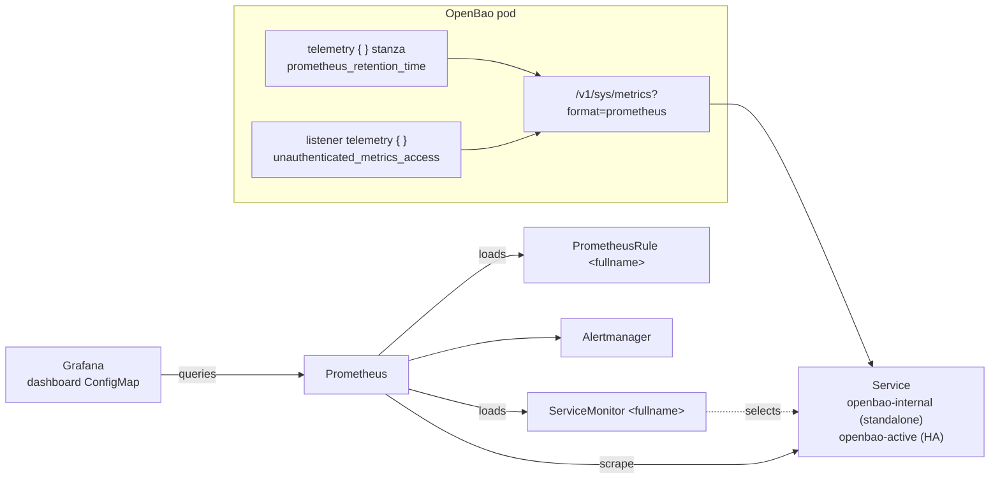

# Observability

This document covers metrics, alerting and dashboards: the OpenBao
telemetry configuration, the Prometheus Operator `ServiceMonitor` and
`PrometheusRule`, and the Grafana dashboard ConfigMap.

- [1. How metrics flow](#1-how-metrics-flow)
- [2. Enable telemetry in OpenBao](#2-enable-telemetry-in-openbao)
- [3. ServiceMonitor](#3-servicemonitor)
- [4. PrometheusRule](#4-prometheusrule)
- [5. Grafana dashboard](#5-grafana-dashboard)
- [6. Complete example](#6-complete-example)
- [7. Logs and health checks](#7-logs-and-health-checks)
- [8. Troubleshooting](#8-troubleshooting)

> Examples in this document have not yet been checked with `helm template`.
> Metric names follow OpenBao 2.x, which keeps the `vault_` prefix
> inherited from Vault (verify with your version: `curl .../v1/sys/metrics?format=prometheus`).

---

## 1. How metrics flow



Three pieces must be in place, and the chart provides only two of them:

| Piece | Who provides it |
|-------|-----------------|
| OpenBao exposes Prometheus metrics | **You**, in the HCL config ([§2](#2-enable-telemetry-in-openbao)) |
| Prometheus discovers the endpoint | The chart: `ServiceMonitor` ([§3](#3-servicemonitor)) |
| Prometheus Operator installed, and it selects the `ServiceMonitor` | **You**: the operator and a matching `serviceMonitorSelector` |

---

## 2. Enable telemetry in OpenBao

The default configs contain the telemetry blocks only as comments. Add two
stanzas to the config of your mode (`server.standalone.config` or
`server.ha.raft.config`):

```hcl
listener "tcp" {
  address = "[::]:8200"
  cluster_address = "[::]:8201"
  tls_disable = 1

  # Allow Prometheus to read /v1/sys/metrics without a token
  telemetry {
    unauthenticated_metrics_access = "true"
  }
}

# Keep metrics in memory for the Prometheus endpoint
telemetry {
  prometheus_retention_time = "30s"
  disable_hostname          = true
}
```

| Setting | Why |
|---------|-----|
| `prometheus_retention_time` | Enables the Prometheus format. Without it, `format=prometheus` returns an error. Use a value larger than the scrape interval |
| `disable_hostname = true` | Removes the host name prefix from metric names, so all pods report the same names |
| `unauthenticated_metrics_access = "true"` | The endpoint is otherwise protected by a token. The alternative is token authentication ([§3.4](#34-authenticated-scraping)) |

Check the endpoint:

```bash
kubectl -n openbao exec openbao-0 -- \
  wget -qO- 'http://127.0.0.1:8200/v1/sys/metrics?format=prometheus' | head
```

With TLS on, use `https` and the CA:

```bash
kubectl -n openbao exec openbao-0 -- sh -c \
  'wget -qO- --ca-certificate=$BAO_CACERT "https://127.0.0.1:8200/v1/sys/metrics?format=prometheus" | head'
```

The image may not contain `wget` or `curl`. Use
`kubectl port-forward svc/openbao 8200:8200` and run `curl` locally instead.

> A **sealed** server returns no useful metrics. Standbys report their own
> metrics, but many core metrics are only meaningful on the active node.

---

## 3. ServiceMonitor

### 3.1 Parameters

| Key | Type | Default | Effect |
|-----|------|---------|--------|
| `serverTelemetry.serviceMonitor.enabled` | bool | `false` | Render the ServiceMonitor |
| `global.serverTelemetry.prometheusOperator` | bool | `false` | Also renders it, regardless of `enabled` |
| `serverTelemetry.serviceMonitor.selectors` | map | `{}` | Labels on the ServiceMonitor. Empty → `release: prometheus` |
| `serverTelemetry.serviceMonitor.port` | string | `""` | Endpoint port **name**. Empty → `http` or `https` (scheme) |
| `serverTelemetry.serviceMonitor.scheme` | string | `""` | Empty → `http` or `https` |
| `serverTelemetry.serviceMonitor.interval` | string | `30s` | Scrape interval |
| `serverTelemetry.serviceMonitor.scrapeTimeout` | string | `10s` | Scrape timeout |
| `serverTelemetry.serviceMonitor.tlsConfig` | map | `{}` | Full `tlsConfig`. Overrides the automatic TLS settings |
| `serverTelemetry.serviceMonitor.insecureSkipVerify` | bool | `false` | TLS on and `tlsConfig` empty: skip certificate verification |
| `serverTelemetry.serviceMonitor.authorization` | map | `{}` | Endpoint `authorization` block |
| `serverTelemetry.serviceMonitor.scrapeClass` | string | `""` | `spec.scrapeClass` (Prometheus Operator 0.73 and later) |

The Prometheus Operator CRDs must be installed. Otherwise `helm install`
fails with `no matches for kind "ServiceMonitor"`.

### 3.2 What it selects

The ServiceMonitor selects **Services**, not pods:

| Mode | Selector | Matched Service | Scraped pods |
|------|----------|-----------------|--------------|
| standalone (incl. dev) | `app.kubernetes.io/name: <SERVICE_NAME>`, `app.kubernetes.io/instance: <release>`, `openbao-internal: "true"` | `<fullname>-internal` | the single pod |
| ha | the same, with `openbao-active: "true"` | `<fullname>-active` | **only the leader** |

The endpoint is `path: /v1/sys/metrics` with `params.format: [prometheus]`.
The ServiceMonitor uses `namespaceSelector.matchNames` with the chart
namespace.

Consequences:

- In HA, standbys are **not** scraped. If you need per-node metrics (Raft
  follower lag, health of every node), add a second ServiceMonitor for the
  headless Service. Example in [§3.6](#36-scraping-all-ha-nodes).
- During a leader election the target briefly disappears. Write alerts with
  a `for:` duration longer than an election.
- `SERVICE_NAME` must match the Service label. See
  [03-global-and-identity.md §1](03-global-and-identity.md#1-identity-values).

### 3.3 TLS scraping

| `global.tlsDisable` | `tlsConfig` | `insecureSkipVerify` | Rendered `tlsConfig` |
|---------------------|-------------|----------------------|----------------------|
| `true` | empty | any | `insecureSkipVerify: true` (harmless over HTTP) |
| `false` | empty | `false` (default) | `serverName: <fullname>`, `ca` from Secret `<tls secret>` key `<caKey>` |
| `false` | empty | `true` | `insecureSkipVerify: true` |
| any | set | any | your `tlsConfig` as is |

The default TLS case reads the CA from the chart's TLS Secret. The Secret is
in the OpenBao namespace, and the ServiceMonitor is in the same namespace, so
the Prometheus Operator can read it. The certificate must contain
`<fullname>` as a SAN. The chart-generated certificate does.

With `rawCerts` and no `certs.ca`, the Secret has no `ca.crt` key. Set
`insecureSkipVerify: true`, or provide `tlsConfig` with a CA from another
Secret:

```yaml
serverTelemetry:
  serviceMonitor:
    enabled: true
    tlsConfig:
      serverName: openbao
      ca:
        secret:
          name: corp-ca
          key: ca.crt
```

### 3.4 Authenticated scraping

If you do not want unauthenticated metrics, create a token for Prometheus
and send it as a bearer token.

```bash
kubectl -n openbao exec -it openbao-0 -- sh -c '
bao policy write prometheus-metrics - <<EOF
path "sys/metrics" { capabilities = ["read"] }
EOF
bao token create -policy=prometheus-metrics -period=768h -orphan -field=token'
```

```bash
kubectl -n openbao create secret generic openbao-metrics-token --from-literal=token=<token>
```

```yaml
serverTelemetry:
  serviceMonitor:
    enabled: true
    authorization:
      type: Bearer
      credentials:
        name: openbao-metrics-token
        key: token
```

Renew the periodic token before the period expires, for example with a
CronJob that runs `bao token renew`. Otherwise scraping stops.

### 3.5 Matching your Prometheus

Prometheus Operator only loads ServiceMonitors that match its
`serviceMonitorSelector` and `serviceMonitorNamespaceSelector`. Check what
yours expects:

```bash
kubectl get prometheus -A -o jsonpath='{range .items[*]}{.metadata.namespace}/{.metadata.name}: {.spec.serviceMonitorSelector}{"\n"}{end}'
```

| Prometheus setup | Value |
|------------------|-------|
| `kube-prometheus-stack` installed as release `prometheus` (default) | `selectors: {}` (renders `release: prometheus`) |
| `kube-prometheus-stack` as release `monitoring` | `selectors: { release: monitoring }` |
| Selector `{}` (select all) | any |
| OpenShift user workload monitoring | `selectors: {}` is fine; enable user workload monitoring for the namespace |

`selectors` **replaces** the default `release: prometheus` label. It does not
add to it.

### 3.6 Scraping all HA nodes

Add an extra ServiceMonitor yourself. The chart's `extraObjects` value is
not rendered by any template (see [14-known-issues.md](14-known-issues.md)),
so apply it separately:

```yaml
apiVersion: monitoring.coreos.com/v1
kind: ServiceMonitor
metadata:
  name: openbao-all-nodes
  namespace: openbao
  labels:
    release: prometheus
spec:
  selector:
    matchLabels:
      app.kubernetes.io/instance: openbao
      openbao-internal: "true"
  endpoints:
    - port: http                 # "https" when TLS is on
      path: /v1/sys/metrics
      params:
        format: [prometheus]
      interval: 30s
      relabelings:
        - sourceLabels: [__meta_kubernetes_pod_name]
          targetLabel: pod
```

Sealed standbys are scraped too and may report errors. That is useful for
alerting on sealed nodes.

---

## 4. PrometheusRule

### 4.1 Parameters

| Key | Type | Default | Effect |
|-----|------|---------|--------|
| `serverTelemetry.prometheusRules.enabled` | bool | `false` | Render the PrometheusRule |
| `serverTelemetry.prometheusRules.rules` | list | `[]` | Rules of the single group `<fullname>`. **The object is rendered only when this list is not empty** |
| `serverTelemetry.prometheusRules.selectors` | map | `{}` | Labels. Empty → `release: prometheus` |

`global.serverTelemetry.prometheusOperator: true` also enables it.

### 4.2 Recommended rules

Adjust thresholds and the namespace to your environment. Check the metric
names against your server first.

```yaml
serverTelemetry:
  prometheusRules:
    enabled: true
    rules:
      - alert: OpenBaoTargetDown
        expr: up{job=~"openbao.*", namespace="openbao"} == 0
        for: 5m
        labels: { severity: critical }
        annotations:
          summary: "OpenBao metrics endpoint is down"
          description: "Prometheus cannot scrape {{ $labels.instance }}. The server may be down or sealed."

      - alert: OpenBaoSealed
        expr: vault_core_unsealed{namespace="openbao"} == 0
        for: 1m
        labels: { severity: critical }
        annotations:
          summary: "OpenBao is sealed"
          description: "{{ $labels.pod }} reports sealed. Requests fail until it is unsealed."

      - alert: OpenBaoNoActiveLeader
        expr: sum(vault_core_active{namespace="openbao"}) < 1
        for: 2m
        labels: { severity: critical }
        annotations:
          summary: "No active OpenBao node"

      - alert: OpenBaoHighRequestLatency
        expr: vault_core_handle_request{quantile="0.5", namespace="openbao"} > 500
        for: 5m
        labels: { severity: warning }
        annotations:
          summary: "OpenBao median request latency above 500ms"

      - alert: OpenBaoAuditLogFailures
        expr: increase(vault_audit_log_request_failure{namespace="openbao"}[5m]) > 0
        for: 1m
        labels: { severity: critical }
        annotations:
          summary: "OpenBao fails to write audit logs"
          description: "When every audit device fails, OpenBao rejects requests."

      - alert: OpenBaoLeaseCountHigh
        expr: vault_expire_num_leases{namespace="openbao"} > 100000
        for: 15m
        labels: { severity: warning }
        annotations:
          summary: "More than 100k active leases"

      - alert: OpenBaoDataVolumeFilling
        expr: |
          kubelet_volume_stats_available_bytes{namespace="openbao", persistentvolumeclaim=~"data-.*"}
            / kubelet_volume_stats_capacity_bytes{namespace="openbao", persistentvolumeclaim=~"data-.*"} < 0.15
        for: 10m
        labels: { severity: warning }
        annotations:
          summary: "OpenBao data volume {{ $labels.persistentvolumeclaim }} is more than 85% full"
```

`{{ $labels.x }}` in annotations is Prometheus template syntax. The chart
renders `rules` with `toYaml`, not `tpl`, so Helm leaves it unchanged.

The `vault_core_unsealed` and `OpenBaoTargetDown` alerts need the standby
nodes to be scraped in HA. With the default ServiceMonitor only the leader
is scraped ([§3.2](#32-what-it-selects)).

---

## 5. Grafana dashboard

### 5.1 Parameters

| Key | Type | Default | Effect |
|-----|------|---------|--------|
| `serverTelemetry.grafanaDashboard.enabled` | bool | `false` | Render a ConfigMap per file in `charts/openbao/grafana/dashboards/*.json` |
| `serverTelemetry.grafanaDashboard.namespace` | string | `""` | ConfigMap namespace. Empty → chart namespace |
| `serverTelemetry.grafanaDashboard.defaultLabel` | bool | `true` | Adds `grafana_dashboard: "1"` |
| `serverTelemetry.grafanaDashboard.extraLabels` | map | *(not in values)* | Extra labels. **Read by the template** |
| `serverTelemetry.grafanaDashboard.extraLabel` | map | `{}` | Declared in `values.yaml` and the schema, but **ignored** by the template |
| `serverTelemetry.grafanaDashboard.extraAnnotations` | map | `{}` | Annotations |

The chart ships one dashboard, `grafana/dashboards/dashboard.json`, based on
[Grafana dashboard 23725](https://grafana.com/grafana/dashboards/23725-openbao).
The ConfigMap is named `<fullname>-dashboard` and has the key
`dashboard.json`.

### 5.2 Loading the dashboard

The ConfigMap is picked up by the Grafana **sidecar** (`kiwigrid/k8s-sidecar`),
which is enabled in `kube-prometheus-stack` and in the Grafana Helm chart.
Match the sidecar settings:

| Sidecar setting | Chart value |
|-----------------|-------------|
| `sidecar.dashboards.label: grafana_dashboard`, `labelValue: "1"` | `defaultLabel: true` (default) |
| a different label | `defaultLabel: false`, `extraLabels: { <label>: <value> }` |
| `searchNamespace: monitoring` | `namespace: monitoring` |
| `searchNamespace: ALL` | any namespace |
| folder annotation, for example `grafana_folder` | `extraAnnotations: { grafana_folder: Security }` |

```yaml
serverTelemetry:
  grafanaDashboard:
    enabled: true
    namespace: monitoring
    extraAnnotations:
      grafana_folder: Security
```

Use `extraLabels` (plural) for extra labels. `extraLabel` from
`values.yaml` has no effect.

If the ConfigMap is created in another namespace, Helm still owns it and
deletes it on `helm uninstall`. The installing user needs permission to
create ConfigMaps there.

---

## 6. Complete example

HA with Raft, metrics on the active node, all nodes scraped separately,
alerts and a dashboard, TLS on.

```yaml
global:
  tlsDisable: false

server:
  dev_mode:
    enabled: false
  ha:
    enabled: true
    replicas: 3
    raft:
      enabled: true
      setNodeId: true
      config: |
        ui = true

        listener "tcp" {
          address = "[::]:8200"
          cluster_address = "[::]:8201"
          tls_cert_file = "{{ .Values.server.tls.mountPath }}/{{ .Values.server.tls.certKey }}"
          tls_key_file  = "{{ .Values.server.tls.mountPath }}/{{ .Values.server.tls.keyKey }}"
          tls_min_version = "{{ .Values.server.tls.tlsMinVersion }}"
          telemetry {
            unauthenticated_metrics_access = "true"
          }
        }

        storage "raft" {
          path = "/openbao/data"
          {{- $fn := include "openbao.fullname" . }}
          {{- range $i := until (int .Values.server.ha.replicas) }}
          retry_join {
            leader_api_addr     = "https://{{ $fn }}-{{ $i }}.{{ $fn }}-internal:8200"
            leader_ca_cert_file = "/openbao/tls/ca.crt"
          }
          {{- end }}
        }

        service_registration "kubernetes" {}

        telemetry {
          prometheus_retention_time = "60s"
          disable_hostname = true
        }
  tls:
    source: certManager
    certManager:
      generateIssuer: true

serverTelemetry:
  serviceMonitor:
    enabled: true
    interval: 30s
    selectors:
      release: kube-prometheus-stack
  prometheusRules:
    enabled: true
    selectors:
      release: kube-prometheus-stack
    rules:
      - alert: OpenBaoSealed
        expr: vault_core_unsealed == 0
        for: 1m
        labels: { severity: critical }
  grafanaDashboard:
    enabled: true
```

Config changes need a pod restart (`OnDelete`). See
[04-server-workload.md §2](04-server-workload.md#2-statefulset-behavior).

---

## 7. Logs and health checks

### Logs

```yaml
server:
  logLevel: info
  logFormat: json
```

```bash
kubectl -n openbao logs openbao-0 -f
kubectl -n openbao logs openbao-0 --previous      # after a crash
```

In dev mode, the bootstrap log is a file inside the container:

```bash
kubectl -n openbao exec openbao-0 -- cat /tmp/openbao.log
```

Request logging without audit devices, appended to `server.extraArgs` or set
in the HCL (`log_requests_level = "info"`):

```yaml
server:
  extraArgs: "-log-requests-level=info"
```

Audit logs are separate. See
[05-storage.md §3](05-storage.md#3-audit-storage).

### Health endpoint

`/v1/sys/health` is unauthenticated and suitable for external monitors and
load balancer checks. Status codes are listed in
[04-server-workload.md §5](04-server-workload.md#v1syshealth-status-codes).

```bash
curl -s -o /dev/null -w '%{http_code}\n' https://openbao.example.com/v1/sys/health
```

### Useful CLI checks

```bash
kubectl -n openbao exec openbao-0 -- bao status
kubectl -n openbao exec openbao-0 -- bao operator raft list-peers        # needs a token
kubectl -n openbao exec openbao-0 -- bao operator raft autopilot state   # needs a token
kubectl -n openbao get pods -l component=server \
  -L openbao-active,openbao-sealed,openbao-initialized,openbao-version
```

The `openbao-*` pod labels are set by `service_registration "kubernetes"`
(HA configs by default).

---

## 8. Troubleshooting

| Symptom | Check | Fix |
|---------|-------|-----|
| `no matches for kind "ServiceMonitor"` on install | `kubectl get crd servicemonitors.monitoring.coreos.com` | Install the Prometheus Operator first, or disable the ServiceMonitor |
| Target not in Prometheus at all | ServiceMonitor labels vs `serviceMonitorSelector` ([§3.5](#35-matching-your-prometheus)) | Set `selectors` |
| Target present, `0/0 up`, no endpoints | `kubectl get endpoints openbao-active` | HA: the leader is sealed or `service_registration` is missing. Unseal, check the discovery Role |
| `server returned HTTP status 400` | `format=prometheus` without `prometheus_retention_time` | Add the top-level `telemetry` stanza |
| `server returned HTTP status 403` | Metrics need a token | `unauthenticated_metrics_access` or `authorization` ([§3.4](#34-authenticated-scraping)) |
| `x509: certificate signed by unknown authority` | CA in the TLS Secret | Provide `ca.crt`, use `tlsConfig`, or `insecureSkipVerify: true` |
| `x509: certificate is valid for ..., not openbao` | SANs | Add `<fullname>` to the certificate |
| ServiceMonitor matches nothing after a custom `SERVICE_NAME` | Service label `app.kubernetes.io/name` | The ServiceMonitor and Services use the same value. Check that the Services were redeployed |
| PrometheusRule not created | `rules` is empty | Add at least one rule |
| Dashboard does not appear | Sidecar label and namespace | [§5.2](#52-loading-the-dashboard). Use `extraLabels`, not `extraLabel` |
| Metrics stop after a config change | Pod still runs the old config | Restart the pods |
